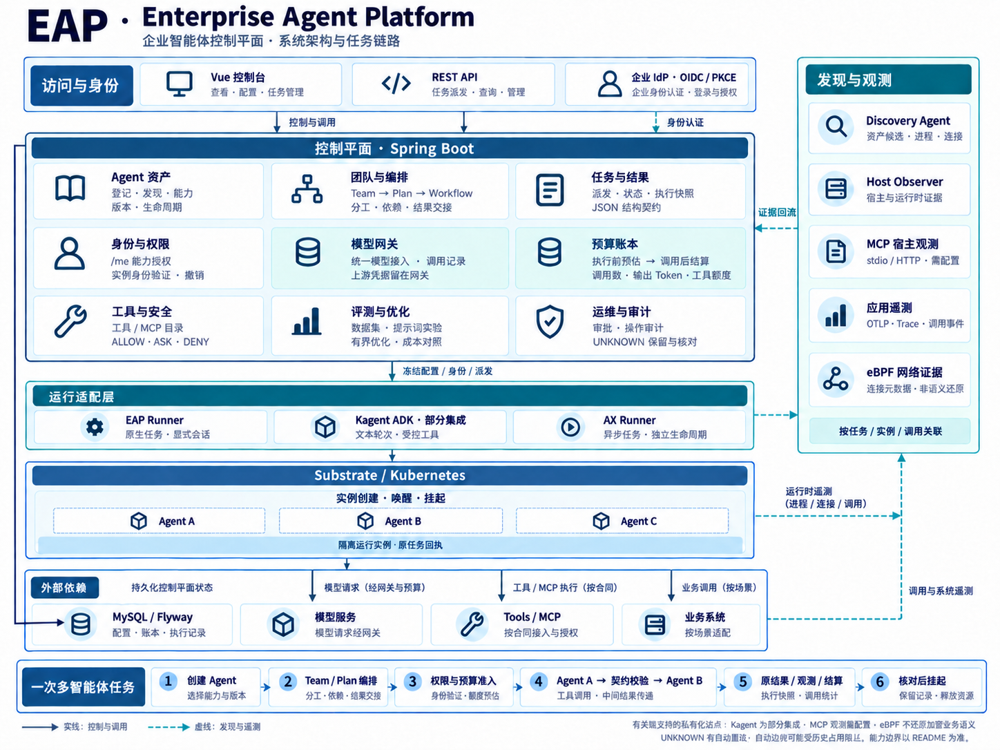

<div align="center">

# EAP · Enterprise Agent Platform

**企业智能体控制平面**

统一管理智能体资产、多智能体协作、运行实例、调用观测与安全治理。

[产品概览](#产品概览) · [核心能力](#核心能力) · [核心技术](#核心技术) · [多智能体任务](#多智能体任务) · [部署与接入](#部署与接入) · [集成范围](#集成范围)

</div>

[](docs/images/eap-system-architecture-detailed.png)

实线表示控制与调用，虚线表示发现与遥测。[查看架构原图](docs/images/eap-system-architecture-detailed.png) · [查看简版总览](docs/images/eap-system-overview.png)

## 产品概览

EAP（Enterprise Agent Platform）面向需要统一管理多个智能体、运行框架和工具服务的企业团队。它将 **Agent 资产、Team / Plan / Workflow、运行实例、任务结果、模型调用、预算与审计证据**关联起来，为智能体应用提供持续运行和管理的基础。

当智能体进入业务流程，团队需要管理的不只是提示词和模型，还包括能力归属、运行版本、任务交接、访问权限、资源消耗和异常处置。EAP 围绕这些对象建立统一的工作流程：

**登记或发现 Agent → 配置运行环境与身份 → 组织团队和计划 → 执行权限与预算准入 → 派发任务并校验交接 → 查看结果、调用与消耗 → 处置异常并收尾实例。**

平台面向三类工作角色：

| 使用者 | 在 EAP 中关注的工作 |
| --- | --- |
| 智能体开发者与应用团队 | 管理能力和版本，组合团队任务，配置结果契约，对照提示词与执行效果 |
| 平台与运维团队 | 部署和管理实例，查看调度与任务状态，关联调用证据，处理未确认结果及资源回收 |
| 治理与安全团队 | 设置策略和预算，管理敏感内容访问，处理审批与安全事件，追踪操作责任 |

**当前交付形态为有实施支持的企业私有化试点。** 控制台安装、运行系统接入、模型和业务工具配置可按环境分阶段推进；生产环境的项目隔离、容量、HA、TLS 与灾备需要结合目标环境单独规划。

### 适用场景

- **多团队智能体资产管理**：把分散的 Agent、能力声明、部署版本和运行实例纳入目录，建立可持续维护的资产关系。
- **多智能体任务协作**：将一个目标拆成有成员分工、执行顺序和输出要求的步骤，保存各步骤的原始结果及交接关系。
- **模型与工具调用治理**：集中处理模型接入、使用额度、受控工具权限和调用记录，减少运行程序各自维护凭据与策略的负担。
- **混合框架运行管理**：在适配范围内统一呈现原生 Runner、Kagent ADK 和异步任务的运行状态与相关记录。
- **既有智能体接入与观测**：结合资产发现、应用遥测、MCP 宿主观测和网络证据，逐步补齐运行关系与调用信息。

具体业务中的检索、报表、运维或审批工具，需要按照各自的数据权限和执行合同进行接入；平台中的通用管理能力不代表任意业务系统已经完成适配。

## 核心能力

### 智能体目录与生命周期

EAP 将“智能体定义”“部署版本”和“实际运行实例”分别管理，使业务能力与一次具体运行保持清晰关联。

在目录中可以登记 Agent 的名称、负责人、所属部门、风险等级与能力声明；部署时选择环境已启用的配置式 Runner、镜像或源码入口。实例建立后，平台关联其路由、实际身份、部署版本和状态，支持相应的运行操作。

发现组件可以补充外部进程、服务和候选资产信息。候选资产进入目录后，仍需确认归属、连接方式与权限；发现记录本身不等于执行授权。

### 团队、计划与工作流

EAP 使用三个对象描述协作：

| 对象 | 作用 | 典型内容 |
| --- | --- | --- |
| Team | 确定参与者与协作关系 | 成员、角色、职责、团队目标 |
| Plan | 将目标拆解为可分配步骤 | 顺序、任务说明、所需能力、执行成员、结果契约 |
| Workflow | 描述执行节点与依赖关系 | 运行后端、输入来源、节点配置、执行路径 |

操作者可以为计划步骤分配团队成员，并定义每一步需要的输出。计划提交后，EAP 生成执行快照，保存成员分工、步骤配置和结果契约；后续修改当前配置，不会替换已经提交的原执行配置。

工作流执行将原结果与步骤状态保留下来，并按配置处理结果交接。在支持结果契约的节点上，上一输出通过结构校验后，才能成为下游的有效输入。

### 任务工作台与运行调度

任务工作台汇集计划、工作流、独立 AX 任务和当前用户的聊天任务，使不同入口产生的执行记录能够按统一方式查询。

任务详情围绕一次原执行呈现：所属 Agent、实例、步骤、原始配置、输出摘要、结构校验、预算和异常原因。调度页面补充任务阶段、等待情况与画像信息；运行监控页面提供 Substrate 实例状态及平台关联。

EAP 保留执行完成、结构合格和业务正确之间的区别。HTTP 返回成功、模型返回文本、JSON 符合结构，是不同层面的结果；最终业务正确性仍需由任务规则、专门核验步骤或人工确认。

### 模型网关与预算账本

模型请求通过网关统一接入，上游模型凭据由网关侧管理。平台记录调用归属、输入与输出 Token、耗时、终态和相关任务信息，供成本分析与执行追踪使用。

预算采用 **调用前预占、收到明确结果后结算** 的方式，并支持以下范围和单位：

| 维度 | 当前支持 |
| --- | --- |
| 预算范围 | 平台、Agent、任务、实验 |
| 计量单位 | 模型调用次数、输出 Token、受控工具额度 |
| 账本信息 | 已用量、预占量、上限、修改版本与原调用归属 |
| 不确定结果 | 保留相关占用与原记录，等待按原意图核对 |

预算准入与账本更新使用数据库事务和并发控制，避免多个调用同时把同一份剩余额度当作可用额度。这里的额度控制针对已接入的调用链路，不等于包含所有供应商费用的金额硬上限。

### 身份、策略与审计

企业登录使用 OIDC / JWT，浏览器采用 Authorization Code + PKCE。平台权限统一定义在后端 `PlatformPermission`，接口拦截与 `/api/platform/me` 读取同一份能力规则；前端按返回的能力显示操作入口。

运行实例使用单独的身份绑定与配送机制。平台关联 Agent、实例标识、实际 Actor UID、身份版本和有效期，支持验证、续期及撤销，使运行身份与具体实例关联。

治理能力包括策略配置、`ALLOW / ASK / DENY` 决策、受控工具授权、审批、安全响应与操作审计。任务元数据和敏感内容分别控制访问，能够查看任务状态并不意味着自动获得原始输出。

### 发现、工具与 MCP 观测

EAP 将不同来源的证据汇入同一观测体系：

| 观测来源 | 提供的信息 | 使用条件 |
| --- | --- | --- |
| Discovery Agent | 资产候选、进程、连接与服务线索 | 部署主机探针并配置采集范围 |
| Host Observer | 宿主和运行时相关证据 | 可信宿主、身份及观测配置 |
| 应用遥测 | Trace、调用事件和任务关联 | 应用或适配器提供相应遥测 |
| MCP 宿主观测 | stdio / HTTP 协议中的工具调用元数据与结果状态 | 支持的协议、宿主接入及关联信息 |
| eBPF 网络证据 | Linux 主机连接事件、进程与网络关系 | 满足内核、权限和探针运行条件 |

这些来源回答的问题不同。网络证据帮助定位“哪个进程连接了哪个服务”，协议证据帮助识别工具调用，应用证据补充任务上下文。EAP 按可获得的任务、实例与调用标识关联它们，并保留证据覆盖范围。

MCP 观测组件以元数据为主，避免把工具参数、结果正文或 HTTP 敏感头默认导出。仅有加密网络连接信息时，不能据此推断完整的工具名称、参数或业务语义；缺少关联信息时，也不能假定已经得到完整调用链。

### 评测、提示词优化与反馈

平台提供数据集、结果标注、提示词对照实验、有界候选优化和团队演化结果入口。使用者可以把候选配置的表现、调用消耗与留出集结果放在一起比较，再决定是否采用。

这些能力适合形成持续改善的工作流程：收集执行问题，建立数据集，提出候选方案，对照结果与成本，保留决策依据。具体任务上的收益依赖数据、评价标准和业务环境，不预设所有优化都会产生稳定提升。

## 核心技术

### 控制平面、执行平面与观测平面

EAP 将平台管理、任务运行和证据采集分开组织：

| 层次 | 主要组件 | 职责 |
| --- | --- | --- |
| 访问层 | Vue 控制台、REST API、企业 IdP | 人员访问、任务管理与身份认证 |
| 控制平面 | Spring Boot API、MySQL、Flyway | 资产、计划、权限、预算、执行状态与审计 |
| 执行平面 | EAP Runner、Kagent ADK 适配、AX Runner | 在各自协议范围内执行任务并返回原回执 |
| 运行底座 | Substrate / Kubernetes | 管理实例创建、唤醒、挂起与运行资源 |
| 观测平面 | OTLP 接入、MCP Observer、Host Observer、Discovery Agent、eBPF 适配 | 汇集应用、协议和宿主证据 |
| 外部资源 | 模型服务、工具、MCP 服务、业务系统 | 提供按合同接入的外部能力 |

这样可以让同一套平台管理规则覆盖多种执行入口，同时明确每种适配器的支持范围。模型请求经网关和预算准入，业务工具遵守各自的权限与效果合同，观测组件负责证据采集与关联。

主要技术栈：**Java 21 / Spring Boot 3.5、Vue 3 / TypeScript / Vite / Element Plus、MySQL 8.4 / Flyway、Go Runner 与发现探针、Python 观测与优化组件**。

### 执行快照与持久状态

任务提交时，EAP 保存执行配置和原请求标识；在支持的运行路径中，派发前记录目标实例及部署关联，包括 Actor UID、部署版本、固定镜像摘要和捕获时间。

任务详情读取原快照与原回执，使历史记录能够说明“这次任务实际使用了什么配置”。原执行未记录到的部署关系会明确显示为未记录，不用当前版本猜测补齐。

部分具备持久恢复合同的路径使用执行责任标识和 epoch 校验更新进度，限制过期工作进程继续写入。外部调用和平台数据库并非一个原子事务，因此平台仍区分明确终态与未知结果，不把进程重启或超时当作外部操作未发生的证明。

### 实例身份绑定与安全配送

身份配送将实际实例 UID、操作编号、随机挑战、身份版本和过期时间共同纳入核对。当前协议使用 Ed25519 对配送消息签名，并使用运行端临时 RSA 公钥进行 OAEP 加密配送；运行端核对签名、挑战和目标实例，再返回确认。

这套机制用于降低身份投递到错误实例、沿用过期连接或接受不匹配配送消息的风险。模型上游凭据保留在网关侧，运行程序通过受控的平台链路访问模型。平台身份协议与生产网络的 TLS、访问控制和密钥管理需要配合使用。

### 结构化结果合同

EAP 的 `EAP_JSON_V1` 合同支持限定范围的 JSON 类型、字段和交接约束。合同随执行冻结，平台保存合同摘要、校验状态及原输出。

例如，一个步骤要求输出数值字段 `sum`，就可以拒绝只有说明文字、字段缺失或类型不符的结果。合同只定义结构：`{"sum":4}` 与 `{"sum":3}` 都可能满足同一结构，具体值仍需要业务规则判断。

### 不确定结果与受控恢复

EAP 明确区分几类运行状态：

| 状态类别 | 含义与处理方向 |
| --- | --- |
| 排队 / 运行中 | 查看阶段、实例和原任务进度 |
| 明确完成 / 明确失败 | 根据原回执处理结果、账本与资源 |
| 策略阻止 / 等待审批 | 查看策略依据和对应审批流程 |
| `EXECUTION_UNKNOWN` | 外部效果可能已发生，先核对原任务与原效果 |

对于已定义持久查询合同的受控工具，可以查询原操作效果。通用业务工具的自动续跑、取消、补偿仍需要逐项适配。

实例回收也遵守占用保护。已有 UNKNOWN 占用可能阻止自动挂起，并使计划停止下游执行。应保留原记录，核对实际实例后通过 EAP 进行明确处置。

## 多智能体任务

下面用一个“计算 → 核验”的合成任务说明完整使用方式。两个 Agent 的创建、部署、计划提交、运行查询和实例收尾都经 EAP 完成。

### 1. 准备两个 Agent

在智能体目录分别登记计算 Agent 与核验 Agent，设置负责人、激活状态与所需能力。为每个 Agent 配置一次模型调用额度和明确的输出 Token 上限，采用当前环境已启用的运行适配器。

部署时确定模型、提示词、运行规格与实例身份。原生 Runner 和 Kagent ADK 的可用性以环境能力及适配范围为准；保存原部署请求编号，状态不明时查询原请求。

### 2. 建立团队与计划

创建 Team，加入两个成员并指定职责；创建一个顺序计划：

| 步骤 | 成员职责 | 输入要求 | 输出要求 |
| --- | --- | --- | --- |
| 计算 | 计算 Agent | 计算 `1 + 2` | `{"sum":3}` |
| 核验 | 核验 Agent | 读取上一结果并判断 `sum` 是否为 3 | `{"verified":true}` 或 `{"verified":false}` |

每个步骤分配具体成员，设置运行后端和所需能力。上一结果通过 `eapPreviousResults` 交给后续步骤。

### 3. 配置结果契约

计算步骤可使用以下合同：

```json
{
  "version": "EAP_JSON_V1",
  "source": "JSON_TEXT",
  "schema": {
    "type": "object",
    "properties": {
      "sum": { "type": "number" }
    },
    "required": ["sum"],
    "additionalProperties": false
  }
}
```

核验步骤将字段改为 `verified`、类型改为 `boolean`。业务上的成功条件是 `sum = 3` 且 `verified = true`，应与结构通过分别查看。

### 4. 提交、跟踪与收尾

确认预算、输入和实例收尾方式后，提交一次计划并保存执行编号。EAP 冻结配置，完成准入、派发、结果接收与交接。

在任务详情查看各步骤状态、原输出、结构校验、实例绑定和调用记录，再核对额度结算。根据环境配置自动挂起实例，或在任务结束且归属明确后通过 EAP 显式挂起、撤销连接。

> 遇到 UNKNOWN，先查询原执行和原外部效果。不要换一个请求编号再次提交来确认原任务是否成功。

详细操作见[运行接入指南](docs/GETTING_STARTED.md)和[双 Agent 样例](examples/arithmetic-plan/README.md)。

## 部署与接入

### 选择使用路径

| 目标 | 入口 | 环境形态 |
| --- | --- | --- |
| 了解控制台和管理对象 | 开发预览 | 内存数据库、开发认证与合成数据 |
| 建立企业登录的管理环境 | [JWT 首次安装](deploy/delivery/install/README.md) | 独立 MySQL、企业 IdP 与控制平面 |
| 执行真实 Agent 任务 | [运行系统接入](docs/GETTING_STARTED.md) | 运行底座、镜像、模型网关、实例身份与预算 |
| 维护已有环境 | [交付工具](deploy/delivery/README.md) | 固定版本检查、源码校验、镜像构建与升级计划 |

所有依赖安装、构建和部署均在远程开发服务器或授权集群执行。本仓库提供源码和交付工具，发布清单中的镜像需要在目标环境准备并核验；示例仓库地址不代表公共镜像下载服务。

### 开发预览

在远程开发服务器准备 Java 21、Maven、Node.js 22 与 npm。从仓库根目录分别打开两个终端：

```bash
# 终端 1：启动后端，使用内存数据库
cd backend
mvn spring-boot:run -Dspring-boot.run.profiles=local
```

```bash
# 终端 2：启动控制台
cd frontend
npm ci
npm run dev -- --host 127.0.0.1
```

通过 SSH 端口转发访问 `http://localhost:5173`，后端健康入口为 `http://localhost:8080/actuator/health`。开发模式不要求登录，内存数据库退出后数据不保留，不应暴露到公网。

开发预览展示平台界面与管理流程。真实任务执行仍需配置运行系统、模型和身份；需要持久化开发数据时，配置 `EAP_DB_URL` 及凭据，并停用内存数据库 profile。

### 企业控制平面安装

首次安装需要准备：

| 依赖 | 准备内容 |
| --- | --- |
| Kubernetes | 专用命名空间、明确的 Namespace UID、镜像访问与运行资源 |
| MySQL | 独立空数据库、迁移权限、持久化与恢复安排 |
| 企业 IdP | OIDC 公共客户端、PKCE S256、issuer、audience、角色映射 |
| 控制台入口 | 浏览器可访问的 origin、`/auth/callback` 回调及目标环境的 HTTPS |
| 凭据 | Secret 或凭据系统中的数据库、运行与模型配置，仅向安装配置填写引用 |

按[配置示例](deploy/delivery/install/config.example.json)准备非敏感参数，再执行：

| 安装步骤 | 作用 |
| --- | --- |
| `bootstrap.py render` | 固定配置与资源，生成安装包及摘要 |
| `bootstrap.py preflight` | 检查目标身份、引用、对象冲突与服务端 dry-run |
| `bootstrap.py install` | 检查独立数据库为空，再创建控制台资源并保存回执 |
| `bootstrap.py status` | 查询原安装对象的状态 |

完整参数与操作顺序见[安装说明](deploy/delivery/install/README.md)。安装器不自动准备 MySQL、IdP、Substrate、Ingress 或 TLS；发生部分失败时，保留原回执并查询实际资源。

**仓库不提供通用初始账号和密码。** 用户由目标环境的 IdP 管理员创建并分配能力对应的角色，凭据不写入 README、示例或提交。

### 接入运行系统

完成控制平面安装后，再按环境接入 Substrate 路由、工作空间、固定运行镜像、模型网关、实例身份配送和预算。可通过 `GET /api/agents/substrate/capabilities` 查看当前环境启用的运行能力。

接入企业工具时，需要定义输入、权限、幂等标识、效果查询、结果与失败语义。平台应能够识别原操作是否完成，再决定后续处置方式；发现或登记一个服务不自动开放其执行权限。

## 控制台工作区

控制台围绕日常操作组织页面，主要入口包括：

| 工作区 | 关注内容 |
| --- | --- |
| 运营工作台与运行指挥大屏 | 平台运行概况与主要工作入口 |
| 智能体目录、详情与发现接入 | 资产、能力、版本、实例及候选资源 |
| Agent 团队与工作流自动化 | 团队分工、计划、工作流配置及提交 |
| 任务工作台、任务运行与 AX 任务 | 原执行记录、状态、输出与下一步处置 |
| 调度与画像、Substrate 运行监控 | 任务阶段、运行实例及资源关系 |
| 运行与观测、证据覆盖与定位 | 调用关联、观测来源与证据覆盖 |
| 成本与价值 | 模型使用、额度与消耗归属 |
| 评估与可靠性、自适应学习、团队优化结果 | 数据集、反馈、实验与候选结果 |
| 策略与审批、安全响应、责任与伦理、审计日志 | 治理规则、审批、事件与操作责任 |

页面操作由当前用户的能力控制，敏感内容权限与运行操作权限分开管理。

## 集成范围

| 主题 | 当前实现范围 | 接入时需注意 |
| --- | --- | --- |
| 原生 Runner | EAP 管理的任务、显式会话、实例身份和模型调用 | 依赖已启用的运行系统、网关及权限配置 |
| Kagent ADK | 部分运行适配、文本轮次与 `CALCULATE_SUM_V1` 受控工具 | 完整 Kagent 平台、通用多轮工具循环、MCP 执行、子智能体及持久审批恢复不在当前范围 |
| AX Runner | 受支持的异步任务与独立生命周期 | 按 AX 的任务和资源合同管理 |
| MCP | 元数据发现、服务清单、可信宿主 stdio / HTTP 观测 | 观测接入与工具执行授权是不同流程 |
| eBPF | Linux 主机连接事件与网络关系证据 | 不能单独还原加密流量中的工具参数和业务语义 |
| 结果合同 | 限定 JSON 类型、字段和交接约束 | 不自动证明事实准确性或业务正确性 |
| 恢复与回收 | 原意图、原回执、UNKNOWN 保留及受控工具效果查询 | 通用自动恢复、取消、补偿和历史占用处置需单独设计 |
| 企业运行 | 平台级能力权限与私有化试点交付 | 跨项目隔离、生产 HA / TLS、容量与整体灾备需要面向目标环境建设 |

## 仓库结构与文档

```text
backend/           Spring Boot API、权限、编排、调度、治理与 Flyway 迁移
frontend/          Vue 控制台、页面和交互组件
runtime/
  agent-runner/    原生任务运行程序与框架适配代码
  kagent-runner/   Kagent 依赖与第三方声明
  ax-runner/       异步任务运行程序
  mcp-observer/    stdio / HTTP MCP 观测
  prompt-optimizer/ 提示词优化组件
discovery-agent/   Go 主机发现探针、内容代理与网络观测适配
examples/          接入和多智能体样例
scripts/           辅助采集与运维工具
deploy/delivery/   发布合同、首次安装、版本检查与镜像构建
docs/              接入、架构图片与专题说明
```

- [运行接入指南](docs/GETTING_STARTED.md)：从企业控制台到一次多智能体执行。
- [双 Agent 样例](examples/arithmetic-plan/README.md)：计算与核验的团队计划。
- [交付工具](deploy/delivery/README.md)：首次安装、维护和升级的入口。
- [安装配置示例](deploy/delivery/install/config.example.json)：目标环境所需的非敏感参数。
- [应用镜像构建](deploy/delivery/images/README.md)：固定基础镜像和应用产物的构建方式。
- [系统架构图说明](docs/images/README.md)：简版、详细版与生成来源。
