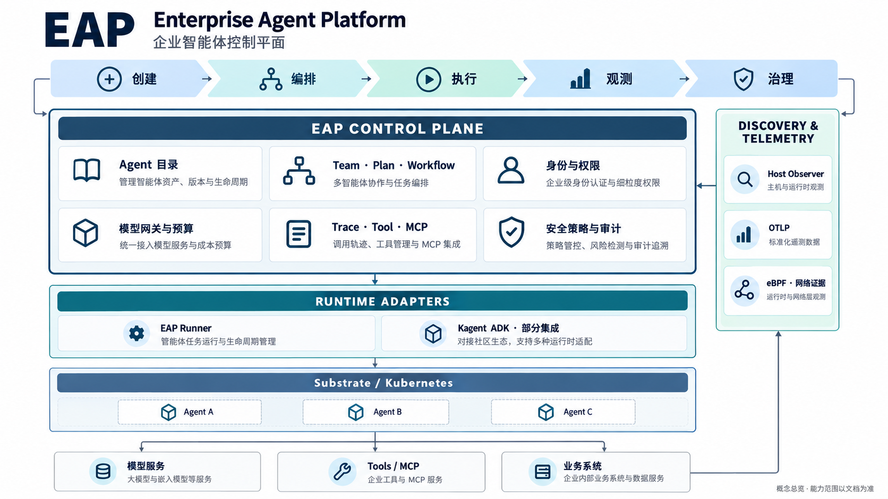

<div align="center">

# EAP · Enterprise Agent Platform

**企业智能体控制平面**

让智能体的创建、协作、运行、观测与治理进入同一套工作流程。

[系统概览](#系统概览) · [开始使用](#开始使用) · [多智能体样例](#多智能体样例) · [能力边界](#能力边界) · [测试与验证](#测试与验证)

</div>



EAP 面向需要统一管理多个智能体、运行框架和工具服务的企业团队。它把 **Agent 资产、Team / Plan / Workflow、运行实例、任务结果、模型费用与审计证据**关联起来，让操作者能够回答：谁在执行、用了什么工具、结果是否合格、消耗了多少预算、异常应该如何处理。

**当前交付阶段：有实施支持的企业私有化试点。** 控制台、核心执行链路和有界集成已经实现并接受远程测试；跨项目隔离、生产 HA / TLS、整体灾备、容量与长期稳定性仍需独立验收。详见[验证说明](docs/VALIDATION.md)。

## 系统概览

一个完整的使用过程是：**登记或发现 Agent → 配置身份与预算 → 组织团队和计划 → 经 EAP 派发 → 验收原结果 → 追踪调用并处置异常**。

| 能力 | 在 EAP 中完成什么 |
| --- | --- |
| 智能体资产与生命周期 | 登记 Agent、声明能力、管理版本、部署运行实例，关联发现到的候选资产 |
| 多智能体协作 | 创建 Team、配置 Plan 与步骤分工；通过可视化 Workflow 定义执行和结果交接 |
| 运行与调度 | 对接 Substrate，支持配置式 Runner、镜像与源码部署入口，以及受支持的异步执行适配 |
| 身份与授权 | OIDC / JWT 登录、统一能力权限、实例身份配送与撤销；前端按 `/api/platform/me` 返回的能力呈现操作 |
| 模型与预算 | 经模型网关统一接入，执行前预留额度，记录调用与结算；不确定结果保留占用 |
| 结果验收 | 冻结执行配置，保存原任务回执，支持有界 JSON 结构契约与步骤交接校验 |
| 工具与 MCP 观测 | 关联 Agent、模型和工具调用；支持受信任宿主的 stdio / HTTP MCP 观测及服务配置 |
| 发现与遥测 | 独立主机探针、协议元数据发现、OTLP 接入、Host Observer 和 Linux eBPF 网络事件适配 |
| 安全与审计 | `ALLOW / ASK / DENY` 策略决策、受控工具授权、审批与操作审计 |
| 评测与优化 | 数据集、提示词对照实验、有界候选优化和团队演化评测；保留成本与留出集结果 |

EAP 区分三种结论：**执行完成、结构合格、业务正确**。例如，模型正常返回不等于 JSON 契约通过；结构通过也不等于答案在业务上正确。

### 架构分工

- **控制平面**：Vue 控制台和 Spring Boot API，负责资产、计划、权限、预算、结果与审计。
- **执行平面**：EAP Runner 与有界框架适配，通过 Substrate 管理实例与任务；模型和工具仍需满足各自的接入合同。
- **观测平面**：应用遥测、MCP 宿主观测、主机探针和网络证据汇入 EAP，按任务与实例身份关联。
- **外部依赖**：MySQL、企业 IdP、运行集群、模型服务及客户工具。控制台首次安装不自动安装这些依赖。

技术栈：Java 21 / Spring Boot 3.5、Vue 3 / TypeScript / Vite / Element Plus、MySQL 8.4 / Flyway、Go Runner 与 Discovery Agent、Python 观测与优化组件。

## 开始使用

根据目标选择入口。**所有依赖安装、测试、构建和部署均在远程开发服务器或授权集群执行。**

| 目标 | 推荐路径 | 得到的环境 |
| --- | --- | --- |
| 查看界面和管理流程 | 下方“开发预览” | 内存数据库与开发认证，适合合成数据演示 |
| 安装可登录的试点控制台 | [首次安装说明](deploy/delivery/install/README.md) | 已有独立 MySQL 和 IdP 上的 JWT 控制台 |
| 接入真实智能体执行 | [运行接入指南](docs/GETTING_STARTED.md) | 配置运行系统、模型网关、实例身份及预算后的任务链路 |
| 检查或升级已有环境 | [交付工具](deploy/delivery/README.md) | 固定版本检查、源码校验及可审阅的升级计划 |

本仓库提供源码与交付工具。发布清单中的镜像需要在目标环境可访问的仓库中准备并核验；**仓库源码可下载不代表配套镜像已公开发布**。不要直接套用另一个环境的地址、实例或凭据。

### 开发预览

在远程开发服务器准备 Java 21、Maven、Node.js 22 和 npm，然后分别启动两个进程：

```bash
# 终端 1：内存数据库，仅用于开发预览；退出后数据不保留
cd backend
mvn spring-boot:run -Dspring-boot.run.profiles=local
```

```bash
# 终端 2：控制台
cd frontend
npm ci
npm run dev -- --host 127.0.0.1
```

经 SSH 端口转发访问 `http://localhost:5173`；后端健康检查为 `http://localhost:8080/actuator/health`。开发模式不要求登录，不应暴露到公网。内存数据库预览不包含可执行的 Substrate 集群、模型凭据或企业登录。

需要持久化开发环境时，配置 `EAP_DB_URL` 和数据库凭据，并停用内存数据库 profile。正式试点使用下述 JWT 安装流程，独立配置数据库、身份、持久化和网络。

### 企业登录与首次安装

安装器需要已存在的 Kubernetes 命名空间、独立空 MySQL 数据库、OIDC 公共客户端和 Secret 引用。按[安装配置示例](deploy/delivery/install/config.example.json)准备非敏感参数，然后依次执行 `bootstrap.py render`、`preflight`、`install`、`status`，完整命令见[安装说明](deploy/delivery/install/README.md)。

身份提供方使用 Authorization Code + PKCE S256，配置 audience、角色 Claim 和 `/auth/callback`。EAP 支持 `VIEWER`、`OPERATOR`、`GOVERNANCE_ADMIN`、`PLATFORM_ADMIN`，实际操作权限统一定义在 `PlatformPermission`。

**仓库不提供通用初始账号或密码。** 账号由目标环境的 IdP 管理员配置；凭据存放在部署环境的 Secret 或凭据管理系统中，不写入 README、配置示例或提交。

## 多智能体样例

可以先用一个“计算 → 核验”的合成任务验证整条链路。创建、部署、调度与观测均通过 EAP 完成：

1. 在“智能体目录”创建计算 Agent 与核验 Agent，声明能力，在“部署”中选择环境已启用的 EAP Runner。
2. 为两个 Agent 配置模型与输出上限，再设置独立模型调用预算。确认实例身份已验证。
3. 在“团队与计划”创建一个 Team，加入两名成员，配置两个顺序步骤并分别分配 Agent。
4. 第一步要求计算 `1 + 2`，输出 `{"sum":3}`；第二步读取上一结果并核验，输出 `{"verified":true}`。分别配置数值与布尔字段的 JSON 结构契约。
5. 提交一次计划，保存 EAP 返回的执行编号。EAP 冻结步骤配置、派发任务、校验结果，再进行交接。
6. 在任务详情核对步骤、原结果、结构验收和预算结算；从观测入口查看关联调用。按配置自动挂起，或完成实例核对后通过 EAP 显式挂起。

这条样例验证控制链路与结果交接。接入客户业务时，还需明确真实数据、工具权限、成功标准及失败处置方式。

> 遇到 `EXECUTION_UNKNOWN`，先查询原执行和原外部效果。不要换一个请求编号重新提交来“确认是否成功”，以免产生重复调用或副作用。

## 能力边界

| 主题 | 当前范围 | 尚不能据此承诺 |
| --- | --- | --- |
| Kagent | 部分 ADK 运行适配、文本轮次和 `CALCULATE_SUM_V1` 受控工具 | 完整 Kagent 平台、通用多轮工具循环、MCP 执行、子智能体或持久审批恢复 |
| MCP | 协议元数据发现、服务清单、受信任宿主的 stdio / HTTP 观测 | 任意应用零配置追踪；发现一个 MCP 服务即允许执行它 |
| eBPF | Linux 主机连接事件与网络关联证据；可与应用遥测互补 | 仅凭加密网络流量还原工具名称、参数、结果与业务意图 |
| 结果契约 | 支持范围内的 JSON 类型、字段及交接校验 | 自动证明事实准确性或客户业务正确性 |
| 预算 | 模型调用数、输出 Token 与受控工具额度的准入和账本 | 包含全部供应商费用的金额硬上限 |
| 故障恢复 | 保留原意图、回执和 UNKNOWN；受控工具可查询原效果 | 任意业务工具自动续跑、取消、补偿或分布式 exactly-once |
| 优化与演化 | 有界实验、候选比较、留出集与成本记录 | 对真实业务稳定增益的普遍保证 |
| 企业交付 | 平台级能力权限、私有化试点安装和有界验收 | 多租户隔离、生产容量、HA、整体灾备已完成 |

## 测试与验证

测试在远程隔离环境执行，浏览器验收面向实际部署版本。当前已完成的统一回归包括：

| 检查 | 结果 |
| --- | --- |
| 后端完整测试与打包 | 1,341 项通过，146 个测试类，无失败、错误或跳过 |
| 前端测试、TypeScript 与生产构建 | 510 项通过，类型检查与构建通过 |
| 实际部署页面巡检 | 4 类角色 × 24 个页面 × 桌面 / 手机，共 192 个场景通过 |
| Python 观测、工具、优化与交付组件 | 181 项通过 |

真实原生 Runner → Kagent ADK 两步协作已通过，创建、派发、结果校验与观测均经 EAP。环境中已有的全局 UNKNOWN 会阻止自动回收，需要核对实例后通过 EAP 显式挂起，并保留原历史。

额外的 MySQL、运行时竞态、发现探针和真实任务测试，以[完整验证说明](docs/VALIDATION.md)的最终记录为准。测试覆盖和未验收项目分别列出；以上结果不替代生产环境验收。

开发者可在远程环境运行基础检查：

```bash
# 后端：MySQL 专项 IT 需要额外的隔离数据库配置
cd backend
mvn -B test
```

```bash
# 前端（从仓库根目录开始）
cd frontend
npm ci
npm test
npm run build
```

后端与前端命令从各自目录独立执行。运行时与探针需要按组件的依赖、构建标签和夹具要求测试；MCP 专用夹具与普通模型 Runner 的测试入口不同。

## 仓库结构

```text
backend/           Spring Boot API、权限、调度、治理与 Flyway 迁移
frontend/          Vue 控制台、组件与前端测试
runtime/           EAP / AX Runner、Kagent 适配、MCP 观测与优化组件
discovery-agent/   Go 主机发现探针、内容代理与观测适配
examples/          协议与接入样例
scripts/           辅助采集和运维工具
deploy/delivery/   发布合同、首次安装、检查、升级计划与镜像构建
docs/              接入说明、能力边界与验证记录
```

进一步阅读：[运行接入](docs/GETTING_STARTED.md) · [验证记录](docs/VALIDATION.md) · [交付入口](deploy/delivery/README.md) · [系统图说明](docs/images/README.md)。
