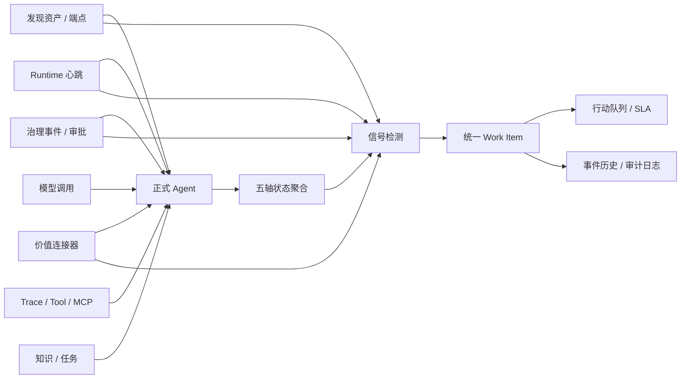

# AgentOps 第一阶段：行动工作台与统一运营模型

## 目标

第一阶段把 EAP 从“按技术界面浏览多个页面”收敛为面向企业 AI 平台管理员和 AgentOps 运营人员的行动控制台。核心原则是：

- 正式 `Agent` 是唯一主实体。
- 发现资产、端点、运行实例、模型调用、Trace、工具、知识、任务和治理事件都是 Agent 的证据或子资源。
- 首页先回答“现在需要处理什么”，再提供全景分析入口。
- 缺失数据保持为 `MISSING`、`NOT_CONNECTED` 或 `NO_DATA`，不伪装成数值 `0`。
- 指标和状态必须声明证据基础、来源、观测时间及新鲜度。
- 开发演示 Agent 标记为 `DEMO`；JWT 生产模式从 AgentOps 主视图和正式 Agent API 中排除这些记录。

## 系统逻辑



## 五轴状态

五个轴互相独立，不能用一个“健康/异常”标签替代：

| 轴 | 状态 | 主要依据 |
|---|---|---|
| 生命周期 | `DRAFT`、`REVIEWING`、`ACTIVE`、`PAUSED`、`RETIRED` | 正式 Agent 目录 |
| 运行健康 | `HEALTHY`、`DEGRADED`、`OFFLINE`、`NOT_CONNECTED` | Runtime 状态与 10 分钟心跳新鲜度 |
| 接入纳管 | `NEEDS_REVIEW`、`NEEDS_OWNER`、`MANAGED`、`MANUAL` | 责任归属与发现资产关联 |
| 观测覆盖 | `FULL`、`PARTIAL`、`MISSING` | Runtime、模型、Trace、工具、知识、治理、内容和任务信号 |
| 风险态势 | `NORMAL`、`ATTENTION`、`HIGH`、`CRITICAL` | 声明风险、开放事项和治理动作 |

数据新鲜度作为附加上下文统一显示：`FRESH`、`AGING`、`STALE`、`NO_DATA`。

## 证据分级

| 证据基础 | 含义 |
|---|---|
| `MEASURED` | EAP 或探针直接测量 |
| `EXTERNAL_RECONCILED` | 与外部业务、账单或连接器结果对账 |
| `HUMAN_CONFIRMED` | 由有权限的人员确认 |
| `DERIVED` | 由多个已知信号按确定规则推导 |
| `ESTIMATED` | 估算值，不能冒充实测 |
| `DEMO` | 开发演示数据，不得混入生产主视图 |

V29 为 `agents` 增加 `record_origin`，并只把三个历史初始化样例按“编码 + 名称”精确标记为 `DEMO`。该迁移不删除或覆盖业务记录。新建 Agent 默认为 `PRODUCTION`。

## Work Item

统一运营事项保存在：

- `agent_work_items`：当前状态、优先级、责任人、组织范围、SLA、证据和解决结果。
- `agent_work_item_events`：创建、状态变更、自动解决和重新打开的事件历史。
- `audit_logs`：所有人工或系统状态变更的审计记录。

### 信号类型

- 发现资产待复核
- Agent 责任人待认领
- 探针机器指纹待复核
- 探针离线
- Runtime 降级或离线
- 已启用 Agent 缺少运行观测
- 治理审批待处理
- 业务价值连接器异常

### 优先级与 SLA

| 优先级 | 默认 SLA |
|---|---:|
| P0 | 15 分钟 |
| P1 | 30 分钟 |
| P2 | 4 小时 |
| P3 | 24 小时 |

### 状态机

```text
OPEN -> CLAIMED -> IN_PROGRESS -> RESOLVED -> CLOSED
                    |      ^
                    v      |
                  WAITING --
```

- 认领或开始处理必须有负责人。
- 等待、解决或关闭必须填写原因。
- 关闭前必须先解决。
- 源信号消失时，系统自动把开放事项标记为已解决。
- 已解决或已关闭的事项若检测到同一信号再次出现，会重新打开、重置 SLA 并增加发生次数。
- 关闭不会覆盖原解决说明和解决证据；关闭理由保存在事件与审计记录中。

## API

| 接口 | 用途 |
|---|---|
| `GET /api/agentops/dashboard` | 行动工作台、指标证据、优先事项和关注 Agent |
| `GET /api/agentops/agents` | 五轴 Agent 服务端分页与筛选 |
| `GET /api/agentops/agents/{id}` | 单 Agent 五轴聚合状态 |
| `GET /api/agentops/work-items` | 运营事项查询 |
| `GET /api/agentops/work-items/{id}/events` | 事项事件历史 |
| `POST /api/agentops/work-items/synchronize` | 手工触发信号同步 |
| `POST /api/agentops/work-items/{id}/transition` | 认领、开始、等待、解决和关闭 |

JWT 模式下，读取遵循现有只读角色；AgentOps 写操作要求 `OPERATOR` 或 `PLATFORM_ADMIN`。

## 前端信息架构

主导航按生命周期重排，保留原 URL 兼容：

1. 运营工作台
2. 资产与接入
3. 运行与观测
4. 治理与安全
5. 成本与价值
6. 自动化

全局顶栏统一控制时间窗口与组织范围。工作台、Agent 目录和 Agent 详情共享同一时间上下文。

## 验证基线

- `mvn -q test`：通过，包括 29 个 Flyway 迁移、Work Item 信号闭环、状态流转、自动解决/重开和 JWT 演示数据隔离。
- `npm run build`：Vue TypeScript 检查与 Vite 生产构建通过。
- 本地 HTTP 冒烟：`dashboard`、`agents`、`work-items` 三组 AgentOps API 返回成功并符合 DTO。
- 浏览器内置视觉验证当前不可用，因此本阶段未声明完成真实浏览器截图验收；部署前仍需做桌面分辨率的视觉和交互回归。

## 第一阶段边界

本阶段建立了主路径和统一运营语义。后续阶段继续处理：

- 真实用户资料、团队与组织树，而不是自由文本组织范围。
- 治理高危动作双人复核和更细粒度权限策略。
- Work Item 通知、升级、值班表和外部工单连接器。
- 旧的运行、知识、价值、治理页面逐步迁移到统一时间上下文和证据组件。
- 前端按路由拆包，降低当前 Element Plus 与历史页面造成的首屏包体积。
