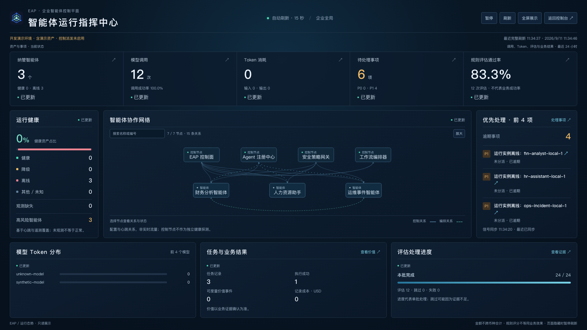

# EAP 核心可靠性与运行大屏（2026-09-11）

本轮已实现可持续扫描的评估投影、真实后台进度和独立运行大屏。2026-09-11 已随 0.3.0.0（6996472）部署，目标 MySQL V44 与公网验收通过，见 [部署记录](DEPLOYMENT_2026-09-11.md)。下文各轮“本地/未部署”描述为当时的历史状态。外部产品调研见 [调研备忘录](RELATED_PRODUCTS_RESEARCH_2026-09-11.md)。

## 运行指挥大屏

入口：侧栏「运行指挥大屏」、首页「打开运行大屏」，独立路由 `/command-center`。

- 1920×1080 一屏展示：资产健康、模型调用、Token、待处理事项、规则评估、协作拓扑、模型分布、任务与业务记录、最新评估批次。
- 支持全屏、暂停、手动刷新、15 秒自动刷新；页面隐藏暂停轮询，离开页面清理计时器并忽略迟到响应。
- 七个已有只读接口独立加载。单源失败保留上次结果并标明失败来源，只有全部刷新成功才更新「最近完整刷新」。后台轮询不重复弹错误消息；认证失效提示返回控制台。
- 空数据和零值分开，多币种不直接合计。环境、演示资产、控制派发状态明确标注。
- 拓扑来自配置与心跳关系，流动虚线不代表真实网络包；控制节点 ONLINE 不构成独立健康检查。每页展示最多 4 个控制节点和 10 个智能体，支持翻页查看其余智能体，页面标明节点及可见关系数量；跨页关系不绘制。
- 小屏按区块纵向排列，拓扑局部横向滚动；支持键盘选节点及减少动画偏好。

设计参考 [AdminLTE 3](https://adminlte.io/themes/v3/) 的信息卡与控制台层次、[D3 图形画廊](https://observablehq.com/@d3/gallery) 的关系图与定量图形表达（访问日期 2026-09-11）。实际采用 Vue、SVG、CSS 实现，没有引入 AdminLTE 或 D3 运行依赖。动态仅用于关系状态、实际进度与数值变化，没有生成虚构趋势。

## 评估扫描与证据

新增 Flyway V44：持久游标、固定扫描上界、带过期时间的独占租约，以及评估任务阶段和处理计数。

- 工具、Trace Span、知识交互改为主键游标分页；每轮固定上界，持续新增不会阻止旧记录回访。
- 扫描逐项续租并保存进度；失败项计数且不阻塞后续项，下一轮全量循环重试。旧持有者不能推进新租约的游标。
- 相关 Trace 单独查询所收到的全部 Span，超过 2000 条跳过，避免使用截断样本判定任务完成。
- 任务完成评估要求显式完成信号；冲突信号、多 Agent 歧义和缺少信号跳过。已接收 Span 不是生产端完整性的保证，证据范围明确为 RECEIVED_SPANS。
- 证据存储限定聚合字段；Span 时长之和不解释为并发任务墙钟耗时。可变输入进入指纹，迟到更新可重新评估；相同输入复用历史结果。
- 后台任务公布 PREPARING/来源扫描/完成阶段和真实处理计数，部分失败为 PARTIAL；错误响应避免泄露底层异常内容。
- 评估页面分为概览、结果、数据集和规则；过程图、Trace 时长条形图均对应实际数据。工作流编辑与执行记录分离，执行时间线来自已有步骤日志。

这里实现的是循环回访与幂等投影，不是消息队列 exactly-once，也不保证扫描前已删除的源记录可恢复。评估计数包含复用结果，进度只代表本批。旧启发式历史结果未删除；规则通过率不等于业务任务成功率。

## 验证

- 后端 `mvn -q test`：202 项，0 失败、错误、跳过；H2 Flyway V1–V44 通过。
- 集成覆盖：超过 500 条积压、跨页 Trace、迟到更新、失败隔离和回访、固定上界、并发租约、过期持有者隔离、PARTIAL 任务进度。
- 前端 `npm test`：54 项通过；`npm run build` 通过。新增网络竞态、断线保留任务、防重复提交、部分刷新失败和页面卸载测试。
- 浏览器：1080p 页面无纵横溢出、390px 无页面横向溢出，全屏进入/退出、暂停按钮、本地 API 与评估批次数据展示通过。
- 本地 H2 注入 6 条合成 Trace / 18 个 Span 验证界面，评估批次完成 24/24，得到 12 个规则结果。没有调用外部模型；截图不是生产业务数据。

## 尚未覆盖

本轮未完成真实 Runtime 断点恢复、强身份认证执行边界、语义 Judge 校准与对抗样本完整体系。这些仍是独立后续工作，不能由大屏或规则评分替代。发布前需在目标 MySQL 验证 V44、备份/升级路径和真实数据负载；本轮未变更远端部署。

## 大屏第二轮优化（2026-09-11，本地）

- 分区记录成功接收时间：失败保留原时间，暂停显示数据年龄，超过 45 秒显示待更新；拓扑过期停止流动动画。
- 继续刷新会立即请求数据；隐藏页面停止请求与拓扑动画。指标标题、异常事项及选中智能体提供详情入口。
- 拓扑按数字顺序分页，切页清除旧选择，数据缩减自动回到有效页；补充键盘选择状态、清除选择按钮和手机横滑提示。
- 区分「资产/事项当前状态」和「调用/评估最近 24 小时」。1440×900 和 1920×1080 无页面溢出，较矮窗口允许区域内滚动。
- 新增 4 项测试覆盖分页、可见边、页码回退、分源更新时间、恢复刷新与详情路由。前端 47/47 与生产构建通过；此次仅变更前端和说明，后端验证沿用上一轮 202/202。

## 大屏第三轮优化（2026-09-11，本地）

- 拓扑支持名称/节点编号搜索（不区分大小写），搜索覆盖全部已接收节点，清空或 Escape 恢复列表；结果保留控制节点上下文。
- 选中节点可切换「只看关联」，并标明跨页/筛选外关系数量，避免将不可见关联误解为不存在。
- 可选 20 秒拓扑轮播，默认关闭；搜索会关闭轮播，选中节点、焦点交互、隐藏页面、暂停刷新、拓扑失败或超过 45 秒未刷新时停止切页。离开页面清理轮播计时器。
- 接口刷新插入新节点后自动定位选中节点所在页；删除节点或缩减列表时回到有效页。手动翻页关闭轮播，避免立即被自动翻页覆盖。
- 增加「放大 / 适应」切换，放大画布局部滚动，保留其他区域。修复放大时居中对齐导致左侧图形无法滚到的问题。
- 前端 51/51，生产构建通过。新增 4 项回归覆盖搜索、刷新保持选择、关联过滤/跨页计数和轮播条件；浏览器以临时 25 节点验证第 2 页范围 11–20 和局部滚动，测试数据未写入后端，随后恢复实际本地接口预览。
- 本轮仍未部署；这不是长期运行压力测试，也没有新增服务端遥测或业务功能。

## 主控制台优化（2026-09-11，本地）

- 首页与导航统一为「运营工作台」，默认展示运营事项队列；拓扑/控制、观测指标切换浏览，避免大图挡在处置入口之前。切换仅控制显示，不改变原控制命令行为。
- 优先级与逾期卡片显示选中状态，点击即回到队列；当前筛选条件和重置入口明确显示。
- 手机端 WorkItemTable 使用事项卡片，保留证据、负责人、SLA、智能体入口和原状态机操作；桌面仍使用表格。空状态只出现一次，证据抽屉与处置弹窗适配窄屏。
- 平台环境提示进入文档流，不再悬浮遮挡内容。侧栏删除硬编码「安全网关在线」，只显示平台接口提供的认证环境与控制派发配置；它不是独立健康探测。
- 增加跳到主要内容入口、导航按钮读屏标签、筛选选中状态；初次加载未知值与0区分，刷新失败保留旧值并明确提示，过期请求失败不能覆盖新视图。
- 前端54/54与构建通过，新增3项测试覆盖筛选回跳、失败保留值和迟到失败隔离。浏览器390px验收4张P1卡片、无页面横向溢出、环境提示为static；没有提交实际认领或控制操作。
- 截图：[手机队列](screenshots/workbench-mobile.png)、[桌面工作台](screenshots/workbench-desktop.png)。本轮没有重跑后端，沿用202/202基线，未部署。
