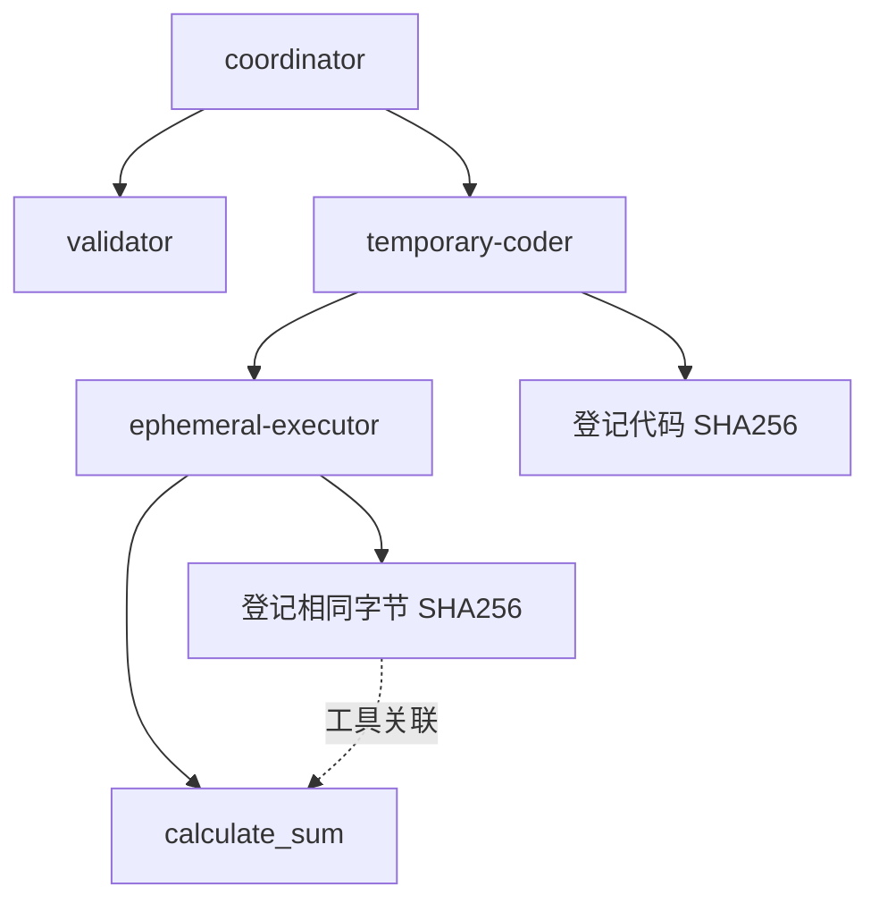

# 短生命周期 Agent、工具与动态代码追踪

短生命周期对象需要在创建和结束时留下事件，不能依赖定时扫描进程。EAP 的 Python SDK 用逻辑执行编号记录同一进程内的 Agent、异步任务和工具；实例身份由 EAP 认证，父子关系由接入方显式报告。

## 本次源码增量

固定求和样例现在根据已校验的数字数量生成受限 Python 源码：生成者 `temporary-coder` 捕获字节快照，删除临时文件，再由嵌套的 `ephemeral-executor` 绑定该快照并执行。只生成固定求和语句，不把数字值、用户源码、路径或模型文本插入程序。



成功路径有四次逻辑 Agent 执行、一次工具调用、两个代码登记记录，共十二条事件。生成者和执行者拥有不同 `runId`，使用同一 Trace、同一进程；两个代码记录的摘要相同。它们是同一代码在两次执行中的登记，不是两个不同版本。旧镜像仍产生九条事件；新 Go Runner 与 Python Worker 必须成套发布。

## 接入方式

```python
with journal.agent("generator"):
    captured = journal.capture_code(generated_bytes, language="PYTHON")
    # 此后可以删除临时文件；不要再次从路径读取执行内容。
    with journal.agent("temporary-executor"):
        executable = journal.bind_code(captured)
        with journal.tool("generated-tool", code=executable):
            result = approved_executor(executable.data)
```

`bind_code()` 只接受同一 Journal、同一 Trace 中已登记的快照。在消费执行中重复绑定同一摘要不会重复登记产物；每次工具调用仍有独立 `toolCallId`。跨日志、跨 Trace 或没有捕获上下文的快照被拒绝。方法本身不执行代码，也不授予执行权限。

开始/结束事件先写入私有 SQLite 日志。异步取消记录 `CANCELLED`；业务异常记录 `FAILED`，不保存异常正文。任务退出后，原事件编号、代码摘要和父子关系仍可补发；补发不会重新创建 Agent 或重新运行代码。初始化失败现在关闭数据库句柄并释放文件锁，避免后续重开一直被旧锁阻塞。

## 证据能说明什么

| 问题 | 当前依据与边界 |
|---|---|
| 子 Agent 是否必须是新进程？ | 不需要。`runId` 与 `parentRunId` 表示逻辑关系，PID 只是辅助信息。 |
| 临时工具消失后还能查询吗？ | 已落盘/已接收的工具开始、结束、所属执行及摘要可继续查询。尚未落盘的事件无法恢复。 |
| 执行的是哪版代码？ | 快照 SHA256 绑定不可变字节；调用方必须执行 `snapshot.data`。SDK 不能独立证明任意调用方遵守了这一点。 |
| 文件被覆盖或删除呢？ | 已捕获字节与元数据不受影响；原始文件路径不进入事件。 |
| 能还原源码吗？ | 不能。当前不保存源码正文，也未实现受权限和保留策略控制的代码归档。 |
| 能自动推断代码由谁生成吗？ | 样例显式登记生成者、消费者及父子关系；v1 协议没有独立的跨流生成来源边，不按相同摘要推断因果。 |
| 能直接执行任意模型生成代码吗？ | 不能。样例只验证受限模板动态生成，任意代码需要独立授权执行器和隔离方案。 |
| eBPF 是否能替代这些事件？ | 内核进程/网络证据不能单独区分同进程逻辑 Agent、工具语义和代码快照；它只能补充系统层线索。 |

适配器仍限于已明确支持的 LangGraph 与 AutoGen Core 场景；跨实例委派、跨消息恢复和其他框架内部关系需要各自接入。部署和测试状态见[验证记录](VALIDATION.md)，后台发送边界见[补发契约](EXECUTION_BACKGROUND_DELIVERY.md)。
