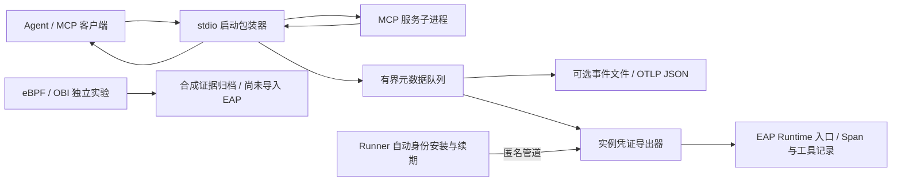

# MCP 与工具的无代码修改观测

2026-10-21。EAP 已有 MCP/工具 Span 和工具调用记录。stdio 观测原型通过启动包装器识别 `tools/call`，无需修改 MCP 服务业务代码，但需要修改启动配置。OBI/eBPF 已进行两次独立合成实验，尚未接入生产采集；包装器与 Kagent MCP 执行器是不同能力。

最新补充：新Agent85 / Workflow39在ate-node2完成同节点OBI对照。任务前后普通容器各80/80 SERVER Span，中间gVisor 8请求/0 Span，判定VISIBILITY_GAP，仅限固定OBI v0.15.2及进程/端口发现配置；不外推所有eBPF方案。EAP协议观察器仍保存6 MCP+1 Agent Span，四角色一致，最终SUSPENDED/REVOKED。22项远程统计测试通过、117份证据核验，探针/专用Map/3临时Pod清理完成。见[同节点证据](evidence/obi-node-20261021/README.md)。下一步接入任务位置留存和来源/覆盖边界展示；未实现生产OBI导入、连续位置证明或自动任务位置持久化。下文“下一步同节点实验”为此前历史计划。

最新补充：EAP [当前运行位置接口](RUNTIME_PLACEMENT.md)已部署，Agent84 / Workflow38 一次任务前后查到同一 Actor/Worker/Pod 与 `ate-node2`；暂停后四角色均返回无当前分配，读取不唤醒。后端完整1297项测试通过，任务仍由既有协议观察器记录6 MCP + 1 Agent Span，最终SUSPENDED/REVOKED。位置快照目前由调用方留存，未自动写入任务，也不能证明连续位置。本轮没有重新运行OBI，旧Agent83裁决保持；下一步在新样例实际节点做前后阳性对照。见[本轮证据](evidence/runtime-placement-20261021/README.md)。

最新补充：固定 OBI v0.15.2 在普通容器获得 160/160 个服务端请求 Span，另外有 320 个内部子 Span；120 次工具调用未识别为 MCP 工具语义。EAP Agent83 / Workflow37 的既有协议观察器仍正确保存 6 MCP + 1 Agent Span。OBI 的 gVisor 阶段零采集因缺少运行时同节点证据记为 `INCONCLUSIVE_PLACEMENT`，不能声称 gVisor 不可见。新增统计门槛、10 项远程测试通过；探针及专用残留 Map 已清理。见[实测评估](OBI_OBSERVATION_ASSESSMENT.md)与[证据](evidence/obi-20261020/README.md)。

最新补充：HTTP/SSE 请求适配器已在 EAP 创建、调度的独立 gVisor Actor 验收：Agent82 / Workflow36 一次任务成功，6个MCP Span/工具记录与1个Agent父Span，四角色一致，模型0；最终显式暂停/撤销。宿主仍需接入，尚无通用配置、生产MCP或完整SDK符合性证明。见[HTTP合同](MCP_HTTP_OBSERVATION.md)、[Actor证据](evidence/mcp-http-actor-20261020/README.md)。库层Python58/后端30项的独立测试及原修复记录另见[原库验收](evidence/mcp-http-20261020/README.md)。

最新补充：同版本替代实例已通过 EAP 真实验收。Agent81 / Workflow35 两次新任务均成功；旧实例经 EAP 删除后原创建请求409，已完成执行的同一requestKey只返回原Run，新实例使用独立UID/任务/Trace，旧观测保持。旧凭证、同名UID漂移及进程状态重建来自隔离测试，未宣称现网强制同名重建或通用崩溃恢复。见[边界说明](MCP_INSTANCE_REPLACEMENT.md)和[本轮证据](evidence/mcp-rebuild-20261020/README.md)。

最新补充：可信镜像内 `EAP_MCP_SERVICES_V1` 启动清单已实现，并由 EAP 新建 Agent80、执行 Workflow34 验证；清单摘要与原任务输出一致，四角色观测覆盖 COMPLETE，最终经 EAP 显式休眠/撤销。服务由可信宿主按名称启动，名称表仅控制观测，不是工具执行权限。没有通用 UI、旧 Actor 自动升级或 Kagent MCP 执行。见[配置合同](MCP_SERVICE_MANIFEST.md)和[验收记录](evidence/mcp-config-20261020/README.md)。

上一轮补充：普通 Runtime 已支持[模型观测约定](WORKFLOW_OBSERVATION_CONTRACT.md)，无模型程序可在新提交中声明预期 0。EAP 新建 Agent79 并执行 Workflow33，任务与工作流成功，模型 0/0、Agent 1/1、3 条 MCP 观测均关联原任务，四角色与浏览器验收通过。执行后由 EAP 显式休眠撤销，未测试自动回收；旧 Workflow31 的模型缺口、失败和全局 UNKNOWN 占用保持。[本轮证据](evidence/observation-contract-20261020/README.md)。该轮没有增加通用 MCP 启动配置或更换默认 Runner。

EAP 接收端已部署明确结果合同，原 Python11 项、后端专项86项及 Agent77 的合成入库验收通过，见[协议入库证据](evidence/mcp-observer-20261020/README.md)。专属实例凭证导出器使用匿名管道交接和续期、固定 Runtime 接收地址及独立有界队列，Python27项通过，见[导出器验收](evidence/mcp-exporter-20261020/README.md)。

现已接通 Go Runner 自动身份安装/续期回调，并由 EAP 创建 Agent78、发布独立合成镜像、配送凭证及派发 Workflow31 的原任务。现网 Runtime 接收端保存 3 个 MCP Span、3 个被动工具记录和 1 个 Agent 父 Span，四角色查询一致。三种 MCP 结果为 SUCCEEDED、FAILED、UNKNOWN，效果均为 UNVERIFIED。没有生产 MCP 流量、收费模型或 Kagent MCP 执行。详见[实例观测验收](evidence/mcp-actor-20261020/README.md)。

上一轮 Workflow31 原任务成功，工作流自动回收却受到现存全局 `LEGACY/UNKNOWN` 占用保护，返回 `SKIPPED_BUSY`，原执行保持 FAILED。核对原任务后，通过 EAP 显式休眠该实例并撤销身份；未清除旧占用或重放业务。观测通过不等于整条工作流通过。不得向不支持新合同的旧 EAP 发送未知结果。

## 采集合同

- 每个服务进程独立关联请求。JSON-RPC 字符串 ID 与数字 ID 分开，允许并发、碎片帧和乱序响应。ID 只在内存中使用。
- 仅记录配置中允许的服务名和工具名、Trace/Span、时间、状态及固定原因枚举。未知工具名变为 `unregistered_tool`；不导出参数、结果、原请求 ID、会话 ID、请求头或错误正文。
- 客户端 `_meta.traceparent` 等内容不建立可信归属。Trace/parent 来自包装器配置；没有配置则创建独立 Trace，关联明确记为 `UNAVAILABLE`。配置值本身也不等于 EAP 已认证任务，后续实例入口仍须认证、命名空间隔离并核对原任务。
- 只有匹配的工具结果才能确认协议成功或失败。`isError=true` 或合法 JSON-RPC 错误记为失败；断连、取消、非法结果、请求 ID 重用、限额或解析失败记为未知。未知不意味着没有副作用，不重试或重新执行工具。
- 默认单帧 64 KiB、并发待响应 128、单进程最多跟踪 4096 个请求 ID、文件队列 256、网络队列 64。达到关联边界后停止该进程的语义关联，继续转发原字节。统计降级与丢失，不把丢失伪装为完整覆盖。
- 事件文件以独占创建和 `0600` 权限写入；不覆盖已有路径。子进程不会继承 `EAP_*` 凭证变量，stderr 不收集。子进程 stdout 关闭后，默认最多等 5 秒退出，再终止/杀死；这是可配置的包装器生命周期约束。
- 网络导出一次尝试、不跟随重定向或使用代理环境变量；无凭证、过期、队列满、关闭丢弃及无法确认接收分别计数。401/403 停用对应租约；旧在途请求不能撤销新版租约。导出失败不改写协议结果、不重跑工具；没有磁盘补投。超时与关闭边界见[运行说明](../runtime/mcp-observer/README.md)。

## EAP 状态兼容

旧 EAP 将普通 OTLP `UNSET` 状态投影为成功。新原型的断连结果不能只发送 `status.code=0`。

新增 `eap.observation.contract=MCP_PROTOCOL_V1`，并明确声明 `outcome`、`reason`、`evidence`、`effect=UNVERIFIED` 和 `task_correlation`。MCP 专用解析仅在协议结果与 OTLP 状态一致时接受成功/失败；缺少合同、未知版本、错误类型及冲突均保守记为 `UNKNOWN`。没有这些字段的旧采集端继续沿用既有行为，不回写旧数据。

`PROTOCOL_RESPONSE` 表示观察到协议响应，`NO_CONFIRMED_RESPONSE` 表示没有确认结果。两者都是被动观测；存储来源为 `OTLP`，不能替代 EAP 工具许可、执行回执、预算结算或数据库效果证明。公共属性仅保留固定枚举；Span 历史支持 `UNKNOWN` 筛选。

## eBPF 能补什么

| 层次 | 可用手段 | 必须保留的边界 |
| --- | --- | --- |
| 进程、连接、HTTP 时延 | eBPF / OBI，进程事件工具 | HTTP 成功不是 MCP 工具成功；协议、TLS 库、内核和运行时决定可见范围 |
| MCP 方法和结果 | stdio 包装器；HTTP 请求宿主适配器 | 需要解析请求/响应语义、关联 ID 和 `isError`；不能只看端口或 HTTP 状态 |
| 进程内函数工具 | ADK 回调或运行时自动插桩 | 普通网络 eBPF 无法直接知道函数的业务名称、参数和结果 |
| 任务与多 Agent 因果关系 | EAP 原任务、实例身份与 Trace 传播 | 时间接近或同一连接只提供关联线索，不是可信父子任务关系 |
| 业务效果 | 目标系统回执、事务或 EAP 效果合同 | 被动协议观测不证明外部事务最终提交 |

判断：采用协议采集加网络/进程观测的组合更合适。OBI 官方描述了跨服务 Trace 的能力及协议限制；gVisor 使用用户态内核，宿主机系统调用与沙箱内部调用不一一对应。因此不能承诺宿主机 eBPF 在当前 GVISOR Actor 中完整捕获工具调用，需要固定版本与运行时的对照试验。

## 后续有界验证

1. 已完成合成 stdio → Runner 实例凭证 → EAP 存储/四角色查询，以及可信镜像内 stdio 清单和不同 UID 替代实例的历史隔离。只部署专用验收镜像，默认 Runner/Kagent 镜像未更换；不能推断既有实例已自动接入。实际续期仅验证派发前，运行中续期和背压来自远程替身测试；实际崩溃恢复尚未验证。协议观测不替代工具授权、效果回执或调度回收。
2. HTTP 请求适配器及专用 gVisor Actor 已完成独立验收：Agent82 / Workflow36，一个任务中的 JSON/SSE 成功、工具错误、断连未知各两条，6 MCP Span/工具记录、1 Agent 父 Span，四角色一致，模型 0；经 EAP 创建、部署、调度和显式暂停撤销。见 [HTTP 合同](MCP_HTTP_OBSERVATION.md)与[原始证据](evidence/mcp-http-actor-20261020/README.md)。它需要可信宿主接入；不是通用透明代理。TLS/OAuth、共享会话、多路流、恢复和通用配置仍待；不自动重试未知工具调用。
3. 第一次固定 OBI 实验已验证普通容器明文 HTTP 计数，发现无会话头样例的工具语义缺口。gVisor 因同节点证据不足尚无有效结论。下一步先在 EAP 暴露/留存 Actor 的权威 Worker 分配，再新建单次样例，在实际节点进行前后普通容器对照；随后独立验证 TLS、stdio、关联与多轮性能。当前顺序延迟样本不能证明生产开销，不能宣称零开销或全量追踪。

## 依据与不确定性

以下为 2026-10-20 访问的官方一手材料。协议使用固定 `2025-06-18` 版本作为此 PoC 的参考，不声称是最新规范或完整符合性认证。

- [MCP Transports](https://modelcontextprotocol.io/specification/2025-06-18/basic/transports)：stdio 子进程与换行消息、Streamable HTTP/SSE、会话及恢复语义。证据强：规范要求。
- [MCP Tools](https://modelcontextprotocol.io/specification/2025-06-18/server/tools)：`tools/call` 与工具错误。证据强：规范要求。
- [OBI Distributed traces](https://opentelemetry.io/docs/zero-code/obi/distributed-traces/)：网络 Trace 与传播能力及约束。证据强：项目文档；本集群已做的普通容器实验及其限制见[专项评估](OBI_OBSERVATION_ASSESSMENT.md)，EAP 原任务关联未验证。
- [gVisor 架构](https://gvisor.dev/docs/architecture_guide/intro/)：用户态内核与宿主系统调用边界。架构事实有文档支持；对本集群 eBPF 可见性的具体影响仍是待验证推断。

SDK 与代理通常比宿主 eBPF 更容易取得工具语义，但启动配置、运行库适配和协议维护都有成本。当前实现 stdio 有界采集、HTTP 请求适配和有界网络导出；OBI 仅完成有限实验，生产导入、gVisor 同节点覆盖、通用 HTTP 代理、持久恢复、既有 Actor 自动接入、全流量覆盖和生产开销均未验收。
