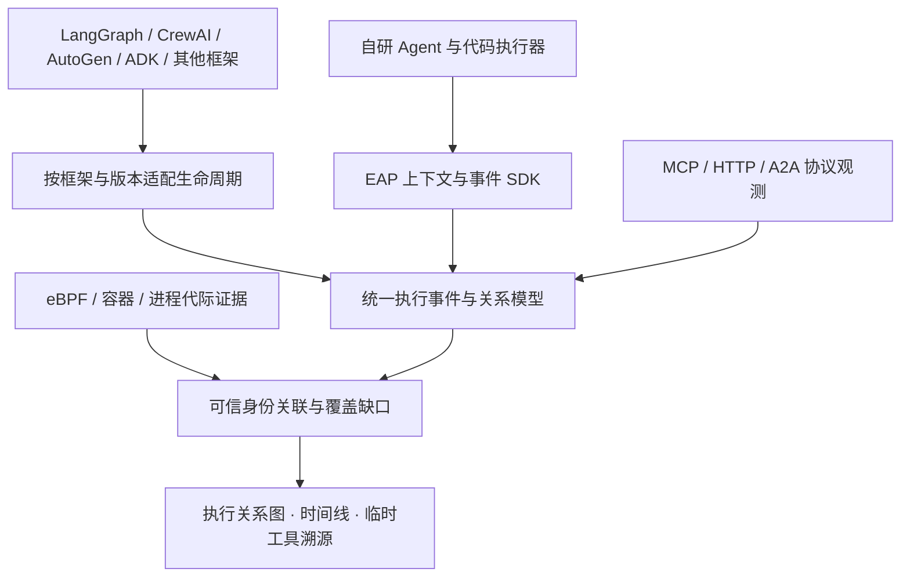

# 跨框架多智能体与临时代码工具观测设计

日期与来源访问日：2026-10-24。**状态：事件接收、查询与显式Python SDK已实现；LangGraph 1.2.17和AutoGen Core 0.7.5的有界观测适配已分别验证。同流执行关系控制台及两个固定求和 IMAGE 模板的 EAP 创建、派发、真实观测和显式休眠已验证；跨运行时/混合框架关联、其余适配器及通用零代码框架创建仍待。** 本文包含后续设计，已实现范围以[事件v1契约](AGENT_EXECUTION_EVENT_CONTRACT.md)、[固定版本适配说明](../runtime/execution-observer/frameworks/README.md)为准，实际通过结果见[验证记录](VALIDATION.md)。创建、运行与观测分别见[框架支持表](FRAMEWORK_SUPPORT.md)；本文不表示EAP已支持所有框架，也不改变已有执行权限、模型预算或Kagent运行边界。

## 1. 结论

EAP 应采用“统一执行模型 + 按版本维护的框架适配器 + 协议观测 + 内核佐证”。先解决同一进程中的多个逻辑 Agent、并发调用和临时代码工具的归属，再扩展框架覆盖。不能以 PID、线程、进程名或网络连接数量推导子 Agent 数量。

子 Agent 可以是协程中的一次调用、长期对象的一次运行、远程服务或者独立沙箱。临时工具可能只在内存中存在，没有文件、子进程或网络请求。只有在框架或执行器边界取得语义事件，才能可靠区分这些情况。eBPF 补充执行环境证据，无法单独恢复任意程序内部的逻辑委派。

## 2. 框架接入矩阵

下表“接入点”是官方文档确认的能力；“EAP 适配工作”是方案判断，均需要固定依赖版本后的验证。框架提供 OTel 或回调，不代表已经验证 EAP 接入、取消语义或崩溃留证。

当前已完成的子集是显式LangGraph Agent节点/工具和AutoGen Core本地直接RPC处理器/工具。它们复用事件SDK，没有实现下表全部目标，也没有转换所有原生OTel Span。Python3.10异步图中断上下文限制、AutoGen非RPC路径及版本边界详见[能力清单](../runtime/execution-observer/frameworks/capabilities.json)。

| 框架 | 已确认的官方接入点 | EAP 适配工作与边界 |
|---|---|---|
| LangGraph / LangChain | LangGraph 暴露流式执行事件、任务与子图输出；当前文档还区分新版 event streaming 和 stream-mode API | 映射运行、任务、子图和工具；由配置声明哪些节点是 Agent。图节点、子图、检查点均不天然等于一个 Agent；恢复、重试和循环调用应保留不同执行/尝试编号。[官方文档](https://docs.langchain.com/oss/python/langgraph/streaming) |
| CrewAI | Agent、Task、Tool 生命周期事件监听；文档还列出 MCP 连接与工具事件 | 监听 Agent/Task/Tool 开始、完成和异常；单独验证委派事件归属、异步执行与版本差异。Task 不等于 Agent，不能按名称合并多次运行。[官方文档，访问时重定向版本 1.15.29](https://docs.crewai.com/v1.15.29/en/concepts/event-listener) |
| AutoGen | 原生 OTel：Runtime、BaseTool，以及当前文档列出的 AgentChat BaseChatAgent | 复用已有 Span，并补消息投递、组聊、handoff 与代码执行器关联；检查单线程运行时中的并发归属。不能把 runtime 支持外推成每个历史版本或扩展都有完整语义。[官方文档](https://microsoft.github.io/autogen/stable/user-guide/core-user-guide/framework/telemetry.html) |
| Google ADK | 插件可观察 Agent、模型和工具生命周期；插件入口按语言与版本区分 | 将调用上下文、转交和工具事件映射到统一模型。Python 文档的插件入口不能直接套用到 EAP 的 Go ADK；EAP 当前 Kagent 适配必须单独验证。[官方文档](https://adk.dev/plugins/) |
| OpenAI Agents SDK | 内建 tracing 包含 Agent 运行中的工具、handoff 等事件，支持自定义 tracing processor | 转换 SDK 的 trace/span ID 和事件类型；核对异步上下文及重复上报。私有部署应配置替换默认 exporter；仅增加 processor 仍会保留默认外发路径。[官方文档](https://openai.github.io/openai-agents-python/tracing/) |
| Microsoft Agent Framework | OTel traces、logs、metrics 与 GenAI 语义约定 | 作为独立适配目标，分别固定 Python/.NET/Go 的版本；不能假定复用 AutoGen 适配器即可覆盖。[官方文档](https://learn.microsoft.com/en-us/agent-framework/agents/observability/) |
| LlamaIndex Workflows | 工作流步骤的 instrumentation、Span 和自定义事件 | 区分 workflow step、Agent invocation、检索与工具；补异步事件因果关系，避免把每个步骤算作 Agent。[官方文档](https://developers.llamaindex.ai/python/llamaagents/workflows/observability/) |
| Pydantic AI | 官方 instrumentation 能输出 Agent、模型和工具的 OTel 观测 | 验证嵌套委派和工具调用的上下文，补动态产物登记；以锁定版本的字段为准。[官方源码文档](https://github.com/pydantic/pydantic-ai/blob/main/docs/capabilities/instrumentation.md) |
| Agno | 官方提供 OTel 接入与 tracing 配置 | 识别 Agent/Team/Workflow 运行边界，并检查与已有全局 TracerProvider 的组合方式，避免以“配置成功”代替“确有事件”。[官方文档](https://docs.agno.com/observability/overview)、[配置说明](https://docs.agno.com/tracing/basic-setup) |
| 自研 / 未支持框架 | 不能预设已有生命周期接口 | 提供最小 SDK：进入执行、委派、进入工具、登记产物、退出；仅有 HTTP/MCP/eBPF 时标注可见范围，保留无法归属的证据，不补造调用关系。 |

Semantic Kernel、Mastra、Dify、Flowise、Langflow 等继续列入候选清单，但本次没有逐项验证其生命周期契约。不能因为发现器能识别这些名称，就在产品中标为“完整观测支持”。

Kagent 与 ADK 必须分开描述：当前 EAP 使用 Kagent 的 Go ADK 模型适配和受控执行入口，并不是接入了完整 Kagent 控制器。原有文本单轮及受控计算工具限制保持；开放任意子 Agent 会涉及预算、工具许可和取消传播，必须另行设计执行契约。

## 3. 统一数据模型

| 对象 | 建议字段 | 语义 |
|---|---|---|
| Agent 定义 | `agentDefinitionId`, `framework`, `frameworkVersion`, `definitionVersion` | 可复用定义；临时角色可以只保存执行期定义，不自动进入正式受管资产目录 |
| Agent 执行 | `agentRunId`, `sessionId`, `taskId`, `runtimeInstanceKey`, `attemptId`, `traceId`, `spanId` | 每次调用独立编号；同一个对象调用两次，是两次执行；重试还要区分尝试 |
| 执行关系 | `sourceRunId`, `targetRunId`, `relationType`, `evidenceSource` | `SPAWN`、`DELEGATE`、`HANDOFF`、`MESSAGE`、`JOIN`、`RETRY_OF`、`RESUME_OF` 等；多来源汇合使用关联边 |
| 工具调用 | `toolInvocationId`, `agentRunId`, `toolDefinitionId`, `artifactVersionId`, `attemptId` | 一次实际执行；“Agent 作为工具”允许同时关联工具调用与被调用 Agent 执行 |
| 代码产物版本 | `artifactVersionId`, `creatorRunId`, `digest`, `language`, `runtimeDigest`, `contentRef` | 可短暂存在的代码或脚本；同路径内容变化产生新版本，多个工具调用可引用同一版本 |
| 执行环境 | `hostBootId`, `pid`, `processStartTime`, `containerUid`, `cgroupId` | 物理证据；与逻辑执行分开保存，避免 PID 复用和多协程共用 PID 的误归属 |

以上是目标领域模型，不是当前数据库已经存在的完整结构。首版仅实现同实例、同 producer、同身份代际内的 `runId`、父子关系、工具调用和代码摘要；同一个 run 的 Trace 必须一致。后续模型中，OTel 的 trace/span/parent 作为互操作基础，EAP 执行编号保留业务生命周期语义；检查点恢复到不同 Trace、typed links 和独立尝试编号需要另外设计与验证，不能从首版父子关系外推。

父子嵌套可以用 parent span 表达；跨消息、并行汇合和接力需 typed links。循环执行以新的运行/尝试节点表示，关系校验避免伪造祖先和非法循环；不能把所有协作压成静态组织树。OTel GenAI Agent 约定仍处于 Development，应固定映射版本，并保留受控的原始字段兼容层。[上下文传播](https://opentelemetry.io/docs/concepts/context-propagation/)、[Agent 语义约定](https://github.com/open-telemetry/semantic-conventions-genai/blob/main/docs/gen-ai/gen-ai-agent-spans.md)

## 4. 同进程并发与跨运行时关联

适配器在真实执行入口创建不可变上下文，至少包含 `agentRunId`、当前 Span、调用编号和可信运行绑定。Python 使用 `ContextVar` 隔离协程上下文，进入后保存 token、退出时在 `finally` 恢复；线程池、后台队列和回调边界显式复制/传递上下文。不要使用模块级可变的“当前 Agent”变量。[Python 上下文变量文档](https://docs.python.org/3.10/library/contextvars.html)

其他语言采用对应上下文机制，需分别验证。既有 Go Runner 使用的 `context.Context` 不代表已实现上述通用 `agentRunId` 传播。跨进程或消息队列传递 W3C Trace Context 与经授权的 EAP 运行上下文；消费者先验证身份和作用域，再建立父子或因果关联。

**Trace 信息只用于关联，不授予权限。** 不信任提示词、工具参数或任意请求头自报的 Agent 身份；绑定必须来自已认证 runtime、受控代理或已授权适配器。无法验证来源的关联只能标记为声明或候选，不能据此获得其他项目的 Trace/内容访问权。已提供独立项目部署与数据库绑定；同库行级多租户未实现，原生权限与网络隔离仍需目标环境验收。

同一个线程可交替执行多个 Agent 协程，因此即使补上 TID 和时间戳，也不能据此可靠归属每个 syscall。没有执行器显式绑定时，内核事件最多关联到运行环境；只有独占进程/沙箱且绑定明确，才进一步归属具体执行。

## 5. 临时代码工具的留证

推荐链路：`Agent run → 代码生成 → 产物版本 → 工具调用 → 执行环境 → 结果`。

1. 在代码执行器真正接收可执行内容时计算摘要，记录创建者、语言、运行时与依赖版本。记录的是实际执行字节，不能只保存模型声称生成的代码或临时文件路径。
2. 将待执行字节固定为不可变快照，或用等价措施消除“取摘要后内容被替换”的窗口。`exec`/`eval` 等内存代码也必须在执行器边界登记；文件监听无法覆盖。
3. 为每次调用创建 `toolInvocationId`，先写开始事件，再执行，随后写结果/异常/取消事件；删除临时文件不删除调用历史。
4. 默认只保存摘要、尺寸、执行编号和受控的结果引用。代码正文需显式配置、脱敏、权限和保留期控制，优先复用 EAP 的内容保管机制；不默认保存环境变量、完整参数和 stdout。
5. 没有结束回执时显示 `INCOMPLETE/UNKNOWN`，不能把进程消失或 HTTP 断开判定为成功。

代码摘要证明内容版本，不单独证明行为可复现。导入模块、闭包状态、数据与外部服务会影响结果；动态下载依赖也应另有引用证据。这里的“留证”不自动授权执行模型生成的代码，原有工具许可、隔离与预算保护继续生效。

## 6. 事件可靠性与多来源去重

仅依赖结束时导出的 Span，会丢失崩溃前尚未结束的调用。建议同时维护有界的执行事件流：`RUN_STARTED`、`RELATION_CREATED`、`ARTIFACT_REGISTERED`、`TOOL_STARTED`、`TOOL_FINISHED`、`RUN_FINISHED`。由服务端幂等归并为可查询图，再映射到 OTel；控制事件与可采样的详细遥测分开。

每条事件包含 schema/adapter 版本、生产者身份、producer epoch、事件 ID、局部序号、发生与接收时间。局部序号只用于检测本生产者缺口，不建立跨进程全局顺序。处理乱序、重投、结束先于开始与父节点迟到；缺少父节点时暂存待关联，不按名称强行匹配。

EAP 托管的关键执行可要求开始事件持久确认后再启动；外部框架的只读观测默认不承诺阻断执行。后者使用有界本地缓冲，明确上报失败、溢出与缺口；采样、进程突亡和断网均可能使记录不完整，不承诺恰好一次或百分之百恢复。

同一次 MCP 工具可能同时被框架、MCP 代理和内核看见。优先用共享调用编号/经验证的协议请求映射归并，保留三类来源证据；没有确定映射时保持独立记录并展示候选关联，避免重复计算调用数、费用或成功率。时间相近、端口相同不能作为确定的语义归属。

## 7. EAP 当前基础与缺口

**源码确认，2026-10-24：**

- [`TraceSpanKind`](../backend/src/main/java/com/eap/platform/observability/TraceSpanKind.java) 已有 `AGENT`、`TOOL`、`MCP`、`A2A` 等种类；[`OtlpTraceIngestionService`](../backend/src/main/java/com/eap/platform/observability/OtlpTraceIngestionService.java) 保存 `parentSpanId`，并将工具 Span 转成工具调用记录。存在枚举不等于具备框架生命周期采集。
- [`ToolInvocationDtos`](../backend/src/main/java/com/eap/platform/observability/ToolInvocationDtos.java) 已包含 Trace、Span、父 Span、Agent、端点、运行实例、任务和输入/输出引用；通用 OTLP 转工具的路径没有自动补全全部执行绑定。
- [`mcp_session.go`](../runtime/agent-runner/mcp_session.go) 和 [MCP observer](../runtime/mcp-observer/observer.py) 已有受控工具、可信运行上下文及指定协议观测基础，不能覆盖任意进程中的普通函数工具。
- [`kagent_engine.go`](../runtime/agent-runner/kagent_engine.go) 明确限制文本单轮与受控工具路径，尚不是任意多 Agent runtime。
- [当前 eBPF 契约](EBPF_OBSERVER_RELIABILITY.md) 采集连接尝试；未测量工具语义、返回结果或字节，也不能自动识别同进程子 Agent。

**首版已实现：** [`AgentExecutionObservationService`](../backend/src/main/java/com/eap/platform/registry/AgentExecutionObservationService.java) 使用 V91 追加事件表；实例认证与写锁内身份复核、批次事务、事件幂等、序号/关系冲突检查，以及分页事件和关系查询已落地。[Python SDK](../runtime/execution-observer/README.md) 使用 ContextVar 隔离协程，SQLite 持久记录开始/结束和待发事件，临时代码只登记摘要、大小、语言。关系查询标记缺失序号/父节点、未结束调用和顺序矛盾；没有把事件自动转换成现有 OTel Span。[执行关系控制台](AGENT_EXECUTION_CONSOLE.md)已提供按事件流读取、父子关系、工具与代码摘要，以及结构缺口说明；它不扩展现有同流关系契约。

**新增有界适配：** LangGraph显式节点/工具保留函数签名与类型注解，覆盖并发、嵌套子图、重试分次记录、同步中断恢复和临时代码；AutoGen Core捕获本地发送上下文，通过单次消息绑定在接收端恢复父节点，覆盖同运行时直接RPC、共享Agent重复调用与取消。SDK新增显式父上下文和框架控制流不结束策略，不能据此跨运行实例绑定。

**仍待实现：** 其余框架/版本与AutoGen AgentChat等执行方式、跨实例/框架上下文、handoff/消息/汇合/重试/恢复的类型化关系、代码内容与依赖的受控保管、多来源去重、集中丢失报告、跨实例关系展示与按能力展示的覆盖报告。SDK当前是显式接入，不是零侵入自动发现；`AUTHENTICATED_PRODUCER_REPORT`只表示上报者身份经过验证，不是内核或外部系统对业务效果的独立证明。字段白名单禁止任意metadata绕过身份或内容控制。

本方案以 EAP 原生能力为目标，不依赖接入 Galileo，也不要求把代码、凭证或私有遥测发送给外部观测服务。若将来接入外部服务，应作为独立出口适配与授权范围评估。

## 8. 有界 PoC 与验收顺序

| 阶段 | 交付 | 通过条件 |
|---|---|---|
| 1：统一契约 | 事件 schema、上下文 SDK、受认证接收与幂等存储；适配器能力声明 | 同 PID 的两个并发逻辑 Agent 互不串链；本地纯函数工具无网络也有记录；重复/乱序事件结果一致；伪造归属被拒绝 |
| 2：临时工具 | 执行前产物摘要、工具开始/结束、缺失结束标记 | 文件执行后删除仍能查版本与调用结果；内存代码也有记录；修改代码后版本变化；崩溃不能显示成功 |
| 3：两类代表框架 | LangGraph 与 AutoGen 的固定版本适配，覆盖图执行及消息驱动 | 分别覆盖委派、并发汇合、取消、重试和嵌套工具；框架内事实与 EAP 图逐项对应 |
| 4：现有运行体系 | 针对 EAP 实际 Go ADK/Kagent 版本的观测适配 | 保持当前预算/工具许可；未授权子执行被阻止；不能把新增观测当作开放执行功能 |
| 5：扩展与混用 | CrewAI、OpenAI Agents SDK 等；两个框架间远程接力 | 跨框架 parent/link 可验证；协议观测不重复计数；不支持的生命周期明确显示缺口 |

PoC 全部在远程隔离目录和专用资源中执行，使用确定性的假模型/受控工具，不调用真实业务，不重放历史 UNKNOWN。每个框架锁定语言、版本和依赖清单；PoC 成功后再扩大到客户使用的具体版本。

阶段1、2已有有界实现和专项用例。LangGraph与AutoGen Core固定模板已通过EAP创建、派发、观测及显式收尾；独立交接样例进一步完成跨实例固定代码交接和双方确认，默认LangGraph/AutoGen模板也已通过显式EAP_CODE_HANDOFF_V1入口复用该流程。类型化重试/恢复、消息与汇合关系、通用源码归档、其他框架及更广的恢复关系仍需实现。实际Go ADK内部Agent/工具回调、注册树子调用与中央投递报告已有有界适配，零代码入口仍限单Agent。具体版本和范围见[框架支持](FRAMEWORK_SUPPORT.md)及[验证记录](VALIDATION.md)。

必须覆盖的故障包括：同线程协程交错、线程池上下文丢失、共享 Agent 对象多次调用、handoff 与 spawn 区别、异步队列、断网、缓冲溢出、执行中取消、结果回传前崩溃、PID 复用、临时文件删除、同路径代码替换和错误父身份。

适配器清单应分别声明 `agentLifecycle`、`delegation`、`toolCalls`、`codeArtifacts`、`asyncContext`、`remoteContext`、`cancel`、`lossReporting`。界面显示“已验证/仅文档确认/缺失/未测试”，并附框架版本、证据来源和最近验证时间。不能用一个“已连接”徽标替代完整能力说明。

## 9. 证据强度与未决事项

外部接入点来自官方文档/官方仓库，证据强于二手介绍，但不是 EAP 的运行测试。EAP 现状由实际源码交叉确认；本次未下载框架依赖、未向外部服务发送私有数据。适配器开销、稳定 API 范围、不同语言的等价性、子 Agent 预算传播、gVisor 内外事件可见性与断网持久策略仍需 PoC。公开文档会更新，落地前以锁定版本的源码与测试为准。
