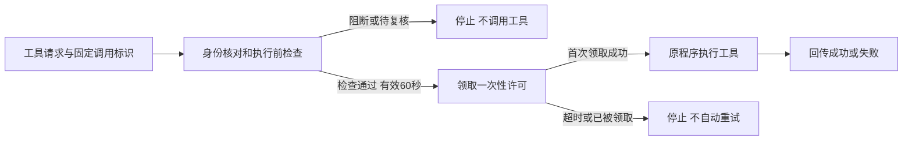

# 外部智能体的工具执行前检查

入口：发现与接入 → 运行环境发现 → 接入验证 → 工具执行检查。页面展示最近30条检查及回执，四类控制台角色均按VIEW_CONSOLE读取元数据。原程序通过实例凭证调用机器接口，不获得人类控制台权限。

## 执行合同



1. 接入程序先保存UUID callId，再提交工具名称、类型、32位Trace ID和JSON参数。EAP从实例凭证固定Agent/endpoint/实例归属，对Trace按实例映射，拒绝客户端覆盖归属或治理决策。
2. 复用本地行为检查规则和治理策略的TOOL_INPUT规则。工具名及参数在内存检查，敏感字段与特权路径不能仅靠工具名称掩盖。只有行为ALLOW且数据策略允许继续时才生成可领取许可；ASK、阻断、审批、脱敏重检均不执行。本轮不提供人工批准后继续领取原调用的流程。
3. 同一实例/callId绑定工具、类型、Trace和规范化参数摘要。相同检查重放不增加决策；参数或工具变化返回409。许可有效60秒且不超过实例凭证到期时间，绑定本次凭证生成号。
4. 接入程序必须领取一次性许可。数据库事务锁串行处理同一实例的检查、领取和回执；并发请求只有一个execute=true。再次领取、过期或未通过检查均execute=false。换发/撤销凭证使旧许可失效。
5. 领取成功后，由原程序执行工具。许可已经领取但响应丢失时不自动重试；EAP可能显示“已领取，结果待确认”，不能推断工具成功或失败。已完成工具不能因回执发送失败而再次执行。
6. 执行方回传SUCCEEDED/FAILED、耗时与可选输出摘要。EAP仅接受本次凭证已领取的调用；相同回执重放复用，改写结果返回409。状态是执行方报告，不是平台对外部副作用的独立证明。

## 接口

全部机器接口为POST，携带X-EAP-Runtime-Key与X-EAP-Runtime-Token（也接受Bearer实例凭证）。缺失、过期、撤销或未握手的凭证401；目录须ACTIVE且运行实例UID/模板匹配。

| 接口 | 请求字段 | 结果 |
| --- | --- | --- |
| /api/runtime-access/v1/tools/check | callId、toolName、toolKind（TOOL/MCP）、traceId、arguments | 检查状态及关联决策 |
| /api/runtime-access/v1/tools/claim | callId | execute布尔值及当前调用状态 |
| /api/runtime-access/v1/tools/receipt | callId、outcome、durationMs、可选outputDigest | 已保存的执行方回执 |
| GET /api/registry/runtime-tools?instanceKey=... | 控制台JWT | 最近30条元数据 |

参数须为不超过64KiB、最多64层的JSON对象。callId为规范UUID；工具名称仅允许96字符以内的标识符，不应放入正文或凭证。许可按签发时的策略生成，在60秒窗口内策略修改不会自动撤回已签发许可；撤销实例凭证可阻止尚未领取的许可。

## 参考客户端

runtime/tool-guard/eap_tool_guard.py仅依赖Python标准库，不自动重试工具操作。默认要求HTTPS；PoC HTTP需显式allow_insecure_http=True。禁止HTTP重定向，以免认证头流向其他服务。响应正文和凭证不写日志或异常消息。

```python
from eap_tool_guard import ToolGuard

# 配置值由运行环境的安全渠道提供；不要写入代码、文件或日志。
guard = ToolGuard(base_url, instance_key, runtime_credential)
result = guard.execute(
    call_id=persisted_call_uuid,
    tool_name="lookup_catalog",
    arguments={"item": "synthetic"},
    trace_id=trace_id,
    invoke=lookup_catalog,
)
# result.value是本地工具结果，result.receipt_confirmed表示回执是否确认保存。
# 回执未确认时保留结果并人工核对，不重跑工具。
```

invoke接收已冻结的JSON参数副本。BLOCKED/REVIEW_REQUIRED/过期/重复领取抛出ToolStopped，通信不确定抛出GuardUnavailable，均在执行前停止。工具已执行而回执发送不确定时返回receipt_confirmed=False，并保留本地结果。

## 数据和范围

V54 runtime_tool_calls保存实例/Agent归属、调用标识、工具标识、Trace、输入摘要、凭证生成号、检查结果、领取/完成时间及可选输出摘要；不保存参数、结果正文或凭证。安全记录只保留工具标识与固定说明，治理记录仅保存分类、字节数、策略动作及摘要。已领取调用进入工具观测，来源RUNTIME_GUARD；受阻请求不冒充实际工具调用。

这是需要原程序适配的执行前检查。程序绕过客户端、伪造工具语义或执行回执时，平台不能证明实际外部行为；启发式规则不等于完整DLP或任意工具的语义分析。强制控制仍需受控工具执行服务、网络策略与适配器配合。TOOL/MCP类型用于分类和归属，不表示已部署通用MCP执行器。输出只上报摘要，未做工具输出正文检查。凭证续期、安全配送、已领取操作的取消/补偿以及生产设施不在本轮。

## PoC验收（2026-09-28）

远程后端323/323、前端125/125与生产构建、参考客户端5/5通过。Agent20的7条检查覆盖许可/回执、敏感参数、特权路径、高风险复核、策略阻断、并发领取与领取响应丢失；合成回调仅1次、模型0次。回调运行于节点参考客户端，外部actor只用于身份/握手验证。四角色API及桌面/390px浏览器通过。最后撤销凭证，三个工具接口401、记录数不变；策略停用，实例休眠。精确镜像与脱敏证据见K8Substrate artifacts/eap-tool-guard-20260928/和PROJECT_MEMORY.md。


## 实例内参考运行程序（2026-09-28）

参考Runner新增显式启用的calculate_sum工具，通过Workflow执行API的context.eapTool指定，先完成平台检查和一次性领取再在actor内部计算。结果、Trace和工具回执走现有EAP通道；私有持久目录保存调用摘要、执行意图及计算结果，恢复后重放不重新执行。受阻或不确定不会回退调用模型。使用与限制见[Runner说明](../runtime/agent-runner/README.md)。

Agent22 / Workflow12已实测返回42、自动休眠、恢复后四并发重放仍只计算1次；敏感参数与Agent范围策略在执行前阻断，模型0次。凭证撤销后新工具不执行，实例最终休眠。此轮运行于actor内部，替代前一轮“只有节点参考客户端回调”的验证范围限制；仍不代表任意工具自动接管。当前只允许固定计算工具，图形界面工具参数配置、真实业务/MCP适配器仍待补齐；旧模板与平台默认镜像未升级。

远程Runner9项顶层测试及5个场景子测试PASS；数据库、后端与前端代码未更改，323/125为既有基线，本轮未重跑。集群网络/进程强制故障未注入；未知响应与进程恢复由远程单元测试覆盖。四角色API及最终浏览器结果见K8Substrate artifacts/eap-actor-tools-20260928/。


首轮Agent21/Workflow11在截图复核中发现eap.tool.call_id使Agent Span误分类为TOOL，产生额外工具观测。已改为eap.guard.call_id；回归断言增加Span类型与按Agent查询的工具记录总数，浏览器也检查总行数。最终Agent22/Workflow12确认只有1条AGENT Span及1条工具观测。首轮任务和错误观测保留，凭证已撤销、实例休眠；过程证据在legacy/并标明缺陷。两轮独立合成计算合计2次、模型0次，不能把最终夹具的1次当成两轮总数。


## 工具节点图形配置更新（2026-09-28）

上文“图形界面待补齐”和“工作流提交 context.eapTool”描述的是上一轮验收状态。本轮已提供节点任务类型与数字表单，保存至 configJson.eapTool，由执行器按节点注入任务；新的全局工具执行上下文返回400。旧验收记录仍保留且不重跑。实例派发前检查受控工具启用，成功还要求回执已确认。当前操作合同见 [WORKFLOW_TOOL_NODES.md](WORKFLOW_TOOL_NODES.md)。
