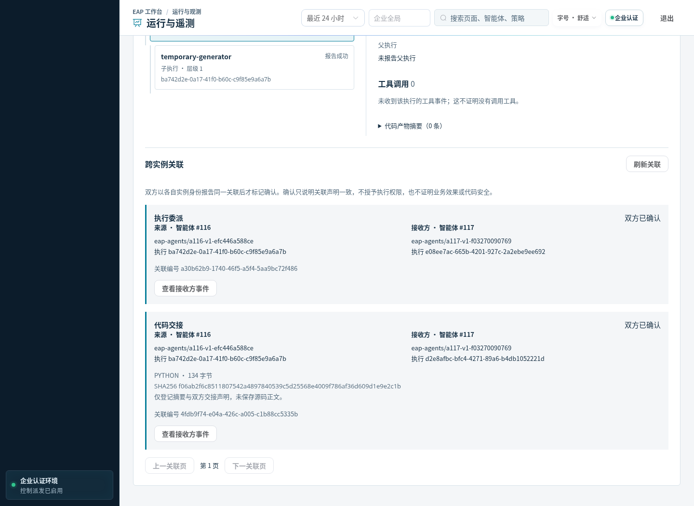
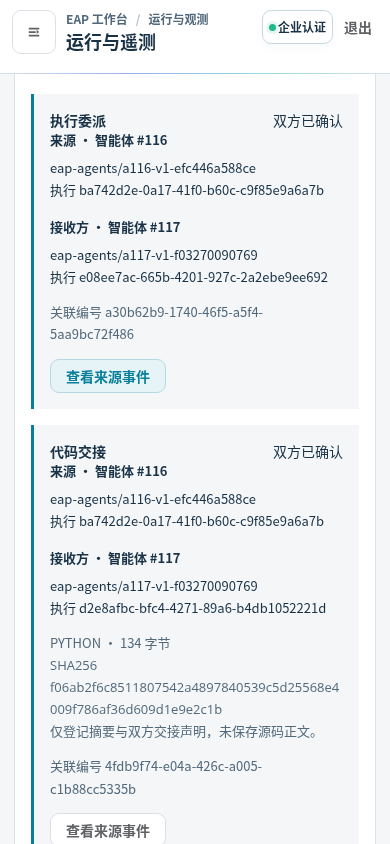

# 真实跨实例短生命周期代码交接

2026-10-25 独立批次 `/root/eap-handoff-sample-20261025-r1` 已完成并封存。EAP 创建 Agent116/117、部署独立 IMAGE 样例，并调度 Workflow58 的生成、执行、双方确认及原意图重发。生成/执行的 Python 子进程退出后，运行实例观察器继续保留原关联。全部构建、测试、浏览器及部署在远程；本机只编辑和核验证据，没有 commit/push。

| 实际结果 | 证据 |
| --- | --- |
| Workflow58 / `wf-exec-87f83762-eadb-4f63-ac58-5a572c01f51c` 成功；一次求和42、模型0 | [工作流与真实关联](evidence/live-proof.json)、[原请求状态](acceptance-state.json) |
| 独立 LangGraph 来源与 AutoGen 接收流，共14事件、5逻辑执行、1工具、2代码登记 | [完整回执](evidence/final-receipt.json) |
| `DELEGATE`、`CODE_HANDOFF` 各1条双方确认；后续4次报告重复确认，没有新代码执行 | [双方确认](evidence/live-proof.json) |
| Go race：原生62、框架11、交接3项；含子用例139/30/5；vet通过 | [race](evidence/race-proof.json)、[vet](evidence/vet-r4.json) |
| Python SDK80、交接13；实际镜像内同一13项复验通过 | [SDK](evidence/observer-python-r4.json)、[交接](evidence/handoff-python-r5.json)、[实际镜像](evidence/image-test-proof.json) |
| 四角色×桌面/手机8真实场景，无合成响应、无业务写入；确认摘要和双向跳转 | [浏览器](evidence/browser-result.json)、[人工截图复核](evidence/manual-visual-review.json) |
| 新实例全部 SUSPENDED/REVOKED/PAUSED；旧业务、预算、计划和UNKNOWN不改 | [旧行逐条核验](evidence/original-records-proof.json)、[清理](evidence/cleanup.json) |

镜像固定为 `10.186.133.66:5001/eap-handoff-sample@sha256:c6e53ce1f97d109a0a2af46045928171b72245d2e42b5a2b21d33b90871bae09`，基于原框架155c6cf5…；[镜像载荷](evidence/runtime-image-proof.json)与受测二进制/源码对应。前后端仍为 `private-pilot-20261025-execution-links-r1` / Schema95，没有替换默认框架镜像或重启应用。

最终旧114事件/6报告保持，加上本批变为128事件/8报告，关联表2行。4个临时Pod及2个ConfigMap已清理，应用UP/Ready/重启0；最后imagefs硬驱逐阈值余量2723657932字节。1036份实现输入与本地及规范源码逐一对应，7份新增/变化已推广。

保留了初次失败：框架构建误混原生模型测试、锁接口编译错误、夹具遗漏OTLP路由、主机缺少race C编译器、测试路径误替换，以及AutoGen不能序列化bytes。最终分别按正确构建类型、接口、临时容器和Base64消息修正验证。首次IMAGE请求错误使用8080被400拒绝；先查询原请求、部署列表和实例均未创建，再沿用同Agent/请求编号纠正为80与`/readyz`，没有放宽身份校验或重复业务。见[部署拒绝的核验与修正](evidence/deployment-validation-correction.json)。

该能力仍是显式接入的固定公开程序样例。它不是任意代码安全执行器、全框架自动观测、通用恢复/补偿或源码归档服务。观测接口只记录元数据，但本样例的**工作流业务输出包含公开程序正文**。本轮没有重新测试后端、MySQL、前端构建、真实内核或容量长稳；不称全系统回归完成或生产就绪。

归档867815字节，SHA256 `01b44bcc6f64d76f22ca9a325b1108abb13c687f828cc11f810bc1e89d9d74ec`，132份导出文件本地核验。实际Secret值、编码及JWT模式扫描零匹配：[扫描](evidence/credential-scan.json)、[本地核验](local-verification.json)。批次已关闭，禁止重放。

