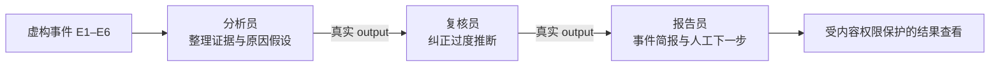

> **更新（2026-10-18）：独立新版样例已完整运行。** Team5 / Plan6 / Agent72–74，3调用、979输出Token，全部创建/调度/观测由EAP完成。完整JSON与简报通过核对，复核措辞问题已在EAP记录。见[新版报告](../../docs/evidence/multi-agent-sample-20261018-v2/README.md)及[完整简报](../../docs/evidence/multi-agent-sample-20261018-v2/incident-brief.md)。下文保留原Plan5失败样例，不能重放其旧命令。

# 三智能体故障分析样例

**已通过 EAP 创建、发布并执行一次：平台协作链路通过，内容验收未通过。** 三步均用满输出额度，前两步 JSON 未闭合、最终简报中途结束。不能把界面的 `COMPLETED / SUCCEEDED` 当作内容质量通过。

团队 **4**、计划 **5**、工作流 **29**；分析员/复核员/报告员分别为 Agent **69 / 70 / 71**。实际使用 **3 次模型调用、2808 输入 Token、3072 输出 Token（其中 2539 为 reasoning）**；工具调用为 0，三个实例均休眠。问题已在 EAP 反馈 **4 / 5 / 6** 中关联各自原 Trace。原运行不重放，不扩大这次预算。

EAP 已有的 Team/Plan、Substrate Runner 和结果交接协议承载了本次样例，没有新增编排框架。配置、部署、身份、调度、休眠、预算、观测和反馈均通过 EAP API 完成；Python 脚本是控制台 API 的客户端，不直接调用模型或 Actor 任务接口。集群命令只用于连接、运行客户端及基础设施健康核对。

[实际回执](../../docs/evidence/multi-agent-sample-20261018/receipt.json)、[原始步骤结果](../../docs/evidence/multi-agent-sample-20261018/outputs.json)、[结果与缺口说明](../../docs/evidence/multi-agent-sample-20261018/README.md)。`engineeringVerified=true`、`liveRunVerified=false` 分别表达工程链路通过和完整内容验收尚未通过。



团队名称为 **样例：订单服务故障分析小组**。在控制台的“团队与计划”（`/orchestration`）选择该团队，即可查看计划、三个成员、步骤分配及原始结果；在“反馈与改进”（`/learning`）查看三条质量问题。本轮完成了真实 API 验证，未另做这个样例的浏览器点击验收。

| 角色 | 输入 | 产物 |
| --- | --- | --- |
| 分析员 | 原始虚构事件 | 事实、原因假设、缺失证据 |
| 复核员 | 原始事件与分析员真实输出 | 修正意见、保留证据、下一步检查 |
| 报告员 | 原始事件与复核员真实输出 | 供人工阅读的中文事件简报 |

事件包含发布后延迟上升、连接池等待及满占用，但没有足够信息证明根因。合格输出应保留这种不确定性，不能声称已回滚或修复。`sample.json` 中的 `acceptance` 是验收条件，不是已得到的模型答案。

## 与当前系统的对应关系

- `POST /api/orchestration/teams` 创建团队；成员分别关联三个独立 Agent。
- 三个 `RUNTIME` 步骤按顺序执行。提交计划时，EAP 将其冻结为 START → AGENT → AGENT → AGENT → END 工作流。
- 原始背景通过 `eapPlan.contextSummary` 传给每个步骤。下游通过 `eapPreviousResults` 得到上一步的 `taskKey`、`agentId`、`output` 和 `outputSha256`。
- 提示词负责定义角色行为；`coordinationMode`、`workspacePolicy`、`requiredCapability` 是描述字段，不构成实际权限控制。
- Agent 身份、预算、派发和结果权限由现有平台实施。原始输出需要 `/me` 中的 `viewContent` 能力。
- 这是固定顺序的协作样例；不包含并行协商、自动组队、输出驱动分支或自动提示词优化。

## 准备过程与防重放

编译、校验、运行和部署均通过项目 `n1.sh` 在 PoC 节点进行。本机只编辑文件和打包，不安装依赖或运行应用测试。准备脚本使用节点已有 `/root/eap-verify-jwt.py` 的 PKCE 登录函数，Secret 和令牌仅留在进程内存，不包含在样例包或回执里。

以下是本次已经完成的准备过程，不应把旧命令作为新演示重跑。原目录为 `/root/eap-sample-incident-20261018-r1`，包摘要已在节点核对。

```sh
python3 /root/eap-sample-incident-20261018-r1/prepare.py prepare
python3 /root/eap-sample-incident-20261018-r1/prepare.py publish
python3 /root/eap-sample-incident-20261018-r1/prepare.py verify
```

`prepare` 创建三个 DRAFT Agent，分别设置 MODEL_CALLS、OUTPUT_TOKENS、TOOL_CLAIMS 为 **0**，然后建立团队、计划及分配。`publish` 使用平台当前固定摘要的 RUNNER 镜像依次创建专属实例，要求发布后休眠。两者均不提交任务、对话或实验。

脚本在每次写请求前持久化意图。已确认操作复用原回执；如果网络返回未确认，不自动重放或换键，必须先按原记录核对。`state.json` 是原始操作日志，不能删除后重跑，不能修改原 `sample.json` 后继续同一次准备。执行后 Agent 已启用且额度已耗尽，准备阶段的 DRAFT/零预算校验不再适用。

## 本次真实演示的独立范围

| 约束 | 本次上限 |
| --- | --- |
| 每个 Agent 的模型调用 | 1 次 |
| 每个 Agent 的累计输出 | 1024 Token |
| 整个样例 | 3 次调用 / 3072 输出 Token |
| 工具调用 | 0 |
| 输入数据 | 仅本文件中的虚构事件及上一步输出 |

用户进一步要求创建、调度和观测均由 EAP 完成后，按已说明的 3 次独立范围执行。本次不是之前待授权的 28 次团队优化验收，也没有继承已关闭实验的额度。输出额度不是输入 Token 或人民币费用上限；网关记录的金额为 0，未经供应商账单核验，不能解释为免费。

`run.py execute-once` 已通过 EAP 核对各自 UID、固定镜像、实际模型/提示词/1024 单次上限和身份有效期，只提高这三个新 Agent 的原零额度至各 1 次/1024，工具仍为 0，未修改 PLATFORM 上限。运行配置读取通过 EAP profile 接口进行，未创建提示词实验；检查后由 EAP 休眠，随后只向计划执行 API **提交一次** `sample.json.execution`。三步调度完全由平台执行。再次运行客户端会因阶段已变化而拒绝提交。

`review.py` 用 EAP 保存的输入摘要逐步核对原请求重建结果，证明完整的原始交接内容到达网关；检查了输出摘要、Agent Span 和唯一 GATEWAY 事件关联。平台观测保持 HASH_ONLY，没有为了验收放开正文采集；原步骤输出仍按内容权限读取。`feedback.py` 将内容问题登记到平台，`export.py` 核对平台总增量、健康和休眠后导出证据；这些步骤未新增模型调用。

下一步应先修复普通 Runner 的截断判断，并通过 EAP 提供、冻结与显示实际模型思考模式及输出上限；补齐不依赖正文采集的终止原因元数据。修复、远程回归及新配置准备好后，另定新计划和预算验证完整简报，不能重放当前计划或默默扩充已用尽的额度。

相关合同：[计划执行](../../docs/PLAN_EXECUTION.md)、[工作流执行](../../docs/WORKFLOW_EXECUTION.md)。
